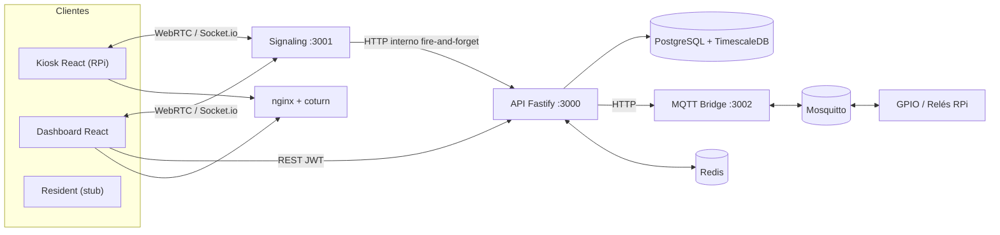
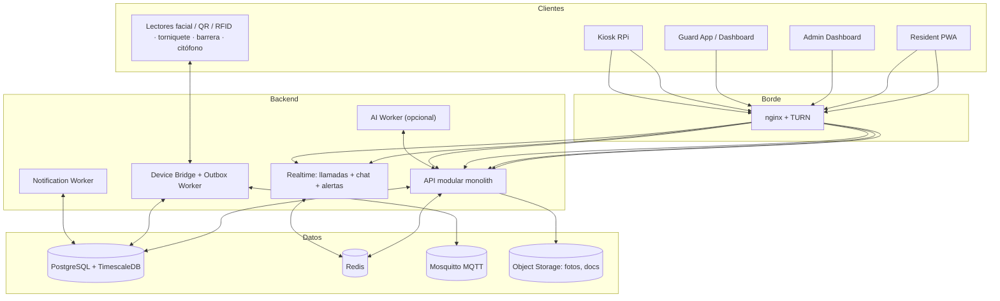
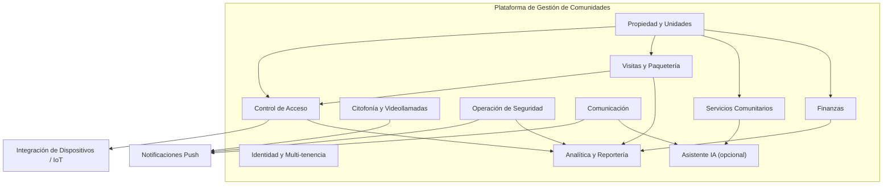
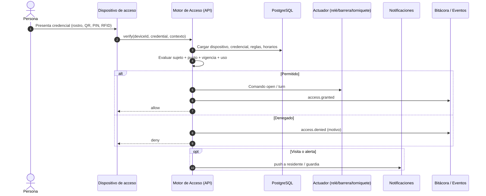
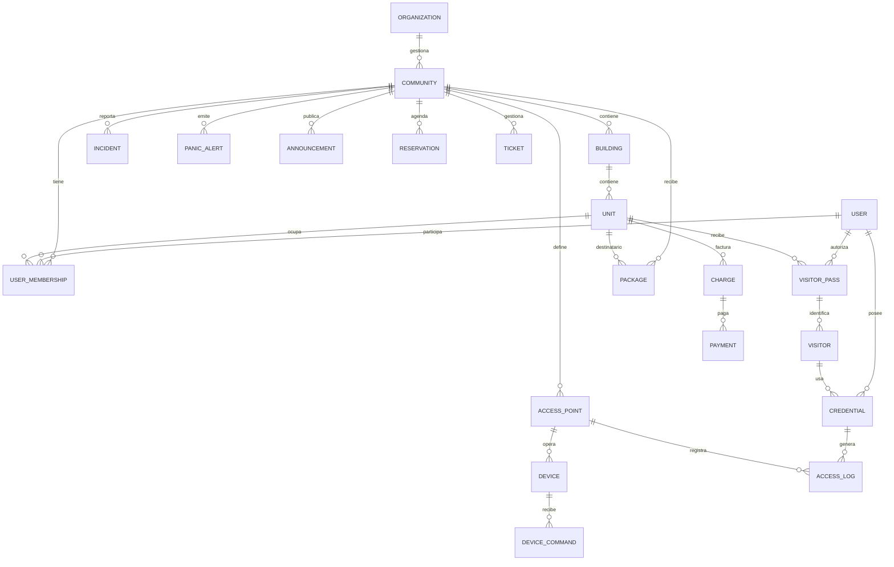
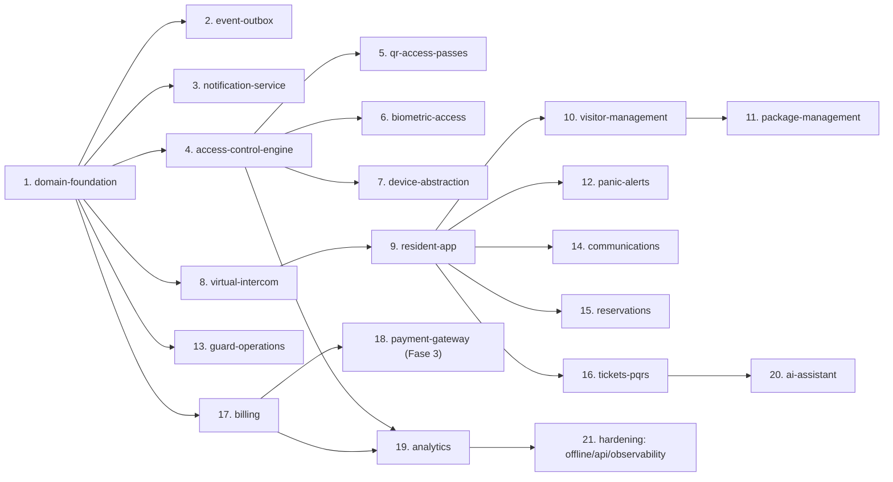

# Arquitectura de la Plataforma de Gestión de Comunidades

Documento de referencia con los diagramas de arquitectura objetivo, el modelo de dominio
y el roadmap por fases. Deriva del análisis del monorepo actual y del relevamiento de
la plataforma Munily.

## Decisiones de arquitectura

- **Multi-tenant por organización.** `organization` es el tenant. Cada organización
  (administradora, empresa de seguridad o comunidad independiente) gestiona una o más
  `communities`. Los `users` son identidades globales y se vinculan a organizaciones,
  comunidades y unidades mediante `memberships`.
- **Monolito modular.** La API es un monolito modular con contextos delimitados
  (`server/api/src/modules/*`). El realtime (llamadas + chat + alertas) y el device
  bridge se mantienen como servicios separados por su naturaleza de I/O.
- **Motor de control de acceso como núcleo.** Toda credencial (QR, PIN, RFID, rostro)
  pasa por el mismo motor de decisión y siempre deja auditoría en `access_logs` +
  evento.
- **Biometría adapter-first.** La verificación se resuelve con un adaptador
  intercambiable: por defecto en el dispositivo (edge, sin costo por API ni envío de
  rostros a la nube) y con opción de proveedor cloud. Nunca se almacenan imágenes
  crudas; solo plantilla cifrada o referencia del proveedor, con consentimiento
  explícito y borrado auditable.
- **QR firmado y rotativo.** Los pases de acceso se emiten como tokens firmados de
  vida corta, verificables offline en el dispositivo. No se usan códigos estáticos.
- **Pasarela de pagos en Fase 3.** La cartera se modela desde la Fase 1/2 con una
  interfaz de proveedor de pagos (`payment_provider`), pero la integración real con
  pasarela se implementa en Fase 3. Esto permite cobrar manualmente primero y enchufar
  la pasarela sin cambiar el dominio.
- **Eventos confiables.** Se reemplaza el envío fire-and-forget por un patrón outbox
  transaccional consumido por un worker.

## Mapa de fases

| Fase | Alcance | Cambios OpenSpec principales |
|------|---------|------------------------------|
| **Fase 1 — Núcleo de acceso** | Fundación de dominio, eventos confiables, notificaciones, motor de acceso, QR, biometría, abstracción de dispositivos | `establish-domain-foundation`, `add-reliable-event-outbox`, `add-notification-service`, `add-access-control-engine`, `add-qr-access-passes`, `add-biometric-access`, `add-device-abstraction` |
| **Fase 2 — MVP comunidad** | Citofonía virtual, app residente, visitas, paquetería, operación de seguridad, pánico, comunicaciones, reservas, tickets, documentos | `add-virtual-intercom-routing`, `add-resident-app`, `add-visitor-management`, `add-package-management`, `add-guard-operations`, `add-panic-alerts`, `add-communications`, `add-reservations`, `add-tickets-pqrs`, `add-documents` |
| **Fase 3 — Finanzas y escala** | Cartera/alícuotas, pasarela de pagos, informes financieros, analítica, IA, offline/API pública | `add-billing`, `add-payment-gateway`, `add-financial-reports`, `add-analytics-dashboard`, `add-ai-assistant`, `add-offline-mode`, `add-public-api-webhooks`, `add-observability-and-retention` |

---

## 1. Arquitectura actual

Núcleo de portería remota: kiosco RPi ↔ operador por WebRTC, apertura de puerta por
relé/MQTT/GPIO, bitácora sobre TimescaleDB y reportes. El modelo sigue centrado en
kioscos y no en comunidades/unidades.

## 2. Arquitectura objetivo (contenedores)

## 3. Mapa de bounded contexts

## 4. Flujo de control de acceso

Aplica a cualquier credencial: rostro (biometría), QR, PIN o RFID. El motor evalúa
sujeto + punto de acceso + vigencia + horario + reglas y siempre audita la decisión.

## 5. Modelo de datos objetivo (núcleo)

> El diagrama muestra el núcleo. Quedan fuera por legibilidad: `biometric_templates`,
> `access_rules`, `shifts`, `rounds`/`checkpoints`, `messages`, `documents`,
> `fee_concepts`, `vehicles`, `pets`, `notification_receipts`,
> `payment_provider`/`payment_method`.

## 6. Roadmap OpenSpec (dependencias)

## 7. Trazabilidad de requerimientos

| Requerimiento | Cambio OpenSpec |
|---------------|-----------------|
| Control de acceso biométrico | `add-biometric-access` + `add-device-abstraction` |
| Generación de códigos QR | `add-qr-access-passes` |
| Botón de pánico en app | `add-panic-alerts` + `add-notification-service` |
| Citofonía | `add-virtual-intercom-routing` + `add-resident-app` |
| Gestión de visitas/paquetería | `add-visitor-management` / `add-package-management` |
| Bitácora/rondas/novedades | `add-guard-operations` |
| Comunicados/chat | `add-communications` |
| Reservas / PQRS | `add-reservations` / `add-tickets-pqrs` |
| Cartera/alícuotas | `add-billing` |
| Pasarela de pagos | `add-payment-gateway` (Fase 3) |
| Multi-comunidad / multi-tenant | `establish-domain-foundation` |
