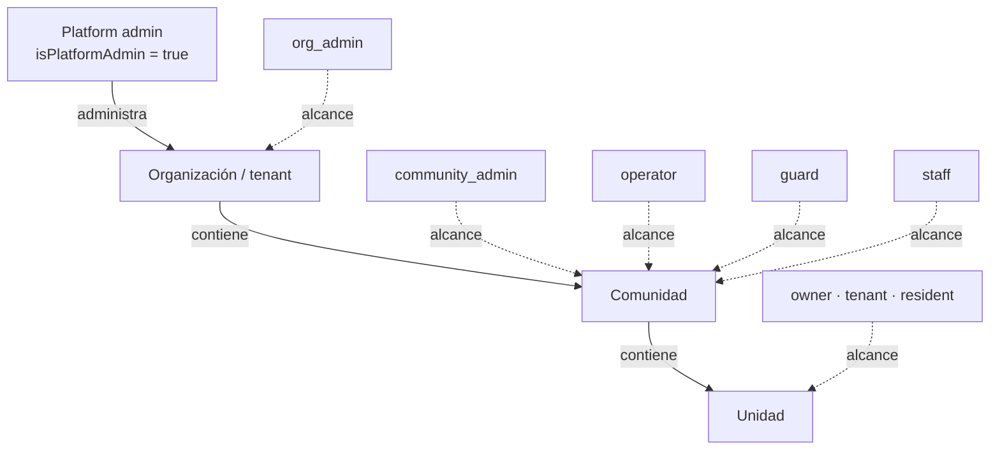
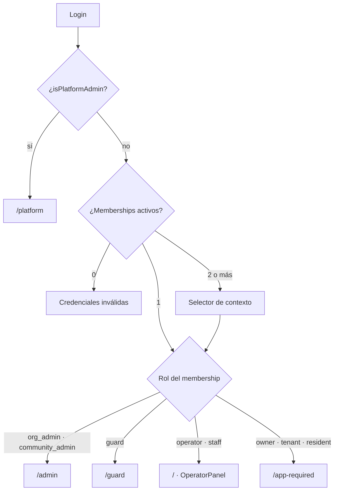
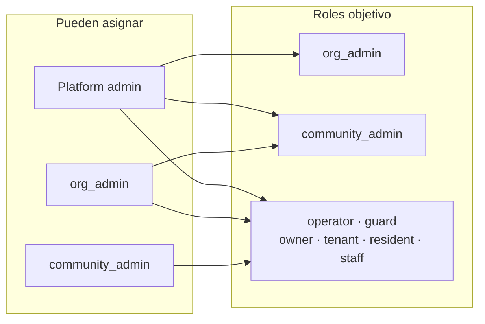
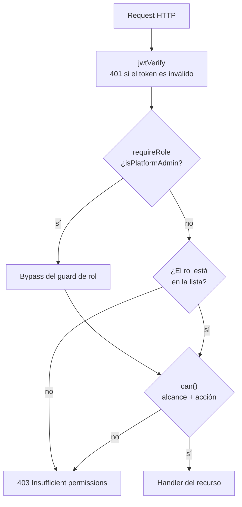

# Roles y permisos

Referencia de los tipos de usuario que existen en PorteriaVirtual y qué puede hacer cada
uno. El contenido sale del código y de los specs (`user-management`,
`tenant-role-guardrails`), no de memoria.

Los diagramas están escritos en Mermaid y se renderizan en GitHub, GitLab, VS Code,
Obsidian y cualquier visor compatible. Las tablas quedan como referencia detallada.

## Fuente de verdad

| Qué                             | Dónde                                                   |
| ------------------------------- | ------------------------------------------------------- |
| Roles disponibles               | `packages/shared/src/enums/index.ts` (`MembershipRole`) |
| Redirección por rol             | `apps/dashboard/src/App.tsx` (`HomePage`)               |
| Visibilidad del menú            | `apps/dashboard/src/components/layout/AppSidebar.tsx`   |
| Guards de rutas del dashboard   | `apps/dashboard/src/components/RequireAuth.tsx`         |
| Guards de la API                | `server/api/src/middlewares/rbac.ts`                    |
| Matriz fina de acciones admin   | `server/api/src/services/admin-permissions.service.ts`  |
| Política de asignación de roles | `server/api/src/services/role-policy.service.ts`        |
| Usuarios demo                   | `packages/database/src/seed.ts`                         |
| Tests E2E                       | `tests/auth.spec.ts`, `tests/navigation.spec.ts`        |

## 1. Concepto clave: rol vs. platform admin

`isPlatformAdmin` **no es un rol**. Es un flag en `users` / `accounts`. Los roles reales
son ocho (`MembershipRole`). Cuando un platform admin inicia sesión, el backend le crea
un membership sintético:

```ts
{ id: 'platform', role: 'staff', organizationId: '', communityId: null, unitId: null }
```

Por eso en la UI el contexto activo se muestra como `staff · `.

Consecuencia: un platform admin puede tener, además, memberships reales de tenant si se
las asignan. El seed no lo hace, así que `superadmin@porteria.local` vive solo en el
contexto de plataforma.

## 2. Tipos de usuario

| Tipo                  | Código                 | Alcance                                       | Landing             | Módulos en el sidebar                                                                                                                                   |
| --------------------- | ---------------------- | --------------------------------------------- | ------------------- | ------------------------------------------------------------------------------------------------------------------------------------------------------- |
| Platform admin        | flag `isPlatformAdmin` | Global, sin tenant                            | `/platform`         | Resumen, Organizaciones, Comunidades, Secciones, Unidades, Invitaciones, Usuarios, Bitácora, Reportes, Historial                                        |
| Admin de organización | `org_admin`            | Organización completa (todas sus comunidades) | `/admin`            | Admin: Resumen, Mi Organización, Comunidades, Secciones, Unidades, Invitaciones, Usuarios · Operación: Operador, Guardia · Análisis: Bitácora, Reportes |
| Admin de comunidad    | `community_admin`      | Una comunidad                                 | `/admin`            | Admin: Resumen, Secciones, Unidades, Invitaciones, Usuarios · Operación: Operador · Análisis: Bitácora, Reportes                                        |
| Operador              | `operator`             | Una comunidad                                 | `/` (OperatorPanel) | Operación: Operador · Análisis: Bitácora, Reportes                                                                                                      |
| Guardia               | `guard`                | Una comunidad                                 | `/guard`            | Operación: Guardia · Análisis: Bitácora, Reportes                                                                                                       |
| Propietario           | `owner`                | Una unidad                                    | `/app-required`     | Ninguno (deriva a Zima QR Access)                                                                                                                       |
| Inquilino             | `tenant`               | Una unidad                                    | `/app-required`     | Ninguno                                                                                                                                                 |
| Residente / familiar  | `resident`             | Una unidad                                    | `/app-required`     | Ninguno                                                                                                                                                 |
| Staff genérico        | `staff`                | Comunidad (asignable)                         | `/` (OperatorPanel) | Ninguno (ver hallazgo 1)                                                                                                                                |

Los residentes (`owner`, `tenant`, `resident`) nunca ven el dashboard: se los redirige a
`/app-required`, la pantalla que invita a usar la app móvil.

### Diagrama: alcance de cada rol



### Diagrama: landing después del login



## 3. Matriz de capacidades del dashboard

Leyenda: ✅ puede escribir · 👁 solo lectura · ⚠️ parcial · ❌ no puede

| Capacidad                           |         Platform         | `org_admin` |      `community_admin`      |     `operator`      |    `guard`     | `owner` / `tenant` / `resident` |
| ----------------------------------- | :----------------------: | :---------: | :-------------------------: | :-----------------: | :------------: | :-----------------------------: |
| Panel de plataforma (`/platform/*`) |            ✅            |     ❌      |             ❌              |         ❌          |       ❌       |               ❌                |
| Resumen tenant (`/admin`)           |            ❌            |     ✅      |             ✅              |         ❌          |       ❌       |               ❌                |
| Mi Organización                     |            ❌            |     ✅      |             ❌              |         ❌          |       ❌       |               ❌                |
| Comunidades del tenant              |            👁            |     ✅      | ⚠️ solo la propia, sin menú |     👁 overview     |  👁 overview   |               ❌                |
| Secciones / Estructuras             |            👁            |     ✅      |             ✅              |         👁          |       👁       |               ❌                |
| Unidades                            |            👁            |     ✅      |             ✅              |         👁          |       👁       |               ❌                |
| Personas / Residentes               |            👁            |     ✅      |             ✅              |         ❌          |       ❌       |               ❌                |
| Usuarios                            |     ⚠️ lista global      |     ✅      |             ✅              |         ❌          |       ❌       |               ❌                |
| Memberships                         |            ⚠️            |     ✅      |    ✅ solo su comunidad     |         ❌          |       ❌       |               ❌                |
| Invitaciones                        |  ✅ invita `org_admin`   |     ✅      |             ✅              |         ❌          |       ❌       |               ❌                |
| Llamadas                            |            ❌            |     ✅      |             ✅              | ✅ solo las propias |       ❌       |               ❌                |
| Kiosks                              |            ❌            |     ✅      |             ✅              |         👁          |       ❌       |               ❌                |
| Disparar relés                      |            ❌            |     ❌      |             ❌              |         ✅          |       ❌       |               ❌                |
| Bitácora / Eventos                  | ⚠️ menú sí, datos vacíos |     ✅      |             ✅              |         ✅          |       ✅       |               ❌                |
| Reportes                            | ✅ pide `organizationId` |     ✅      |             ✅              |         ✅          |       ✅       |               ❌                |
| Socket de operador                  |            ❌            |     ✅      |             ✅              |         ✅          |       ✅       |               ❌                |
| Usar el dashboard                   |            ✅            |     ✅      |             ✅              |         ✅          | ⚠️ placeholder |               ❌                |

El socket de operador se abre solo para `operator`, `guard`, `community_admin` y
`org_admin` (`SocketContext.tsx:134`).

## 4. Matriz de asignación de roles

Quién puede crear o invitar a quién (`role-policy.service.ts`):



| Quien asigna ↓ / Rol objetivo →       | `org_admin` | `community_admin` | `operator` | `guard` | `owner` | `tenant` | `resident` | `staff` |
| ------------------------------------- | :---------: | :---------------: | :--------: | :-----: | :-----: | :------: | :--------: | :-----: |
| **Platform admin**                    |     ✅      |        ✅         |     ✅     |   ✅    |   ✅    |    ✅    |     ✅     |   ✅    |
| **`org_admin`**                       |     ❌      |        ✅         |     ✅     |   ✅    |   ✅    |    ✅    |     ✅     |   ✅    |
| **`community_admin`**                 |     ❌      |        ❌         |     ✅     |   ✅    |   ✅    |    ✅    |     ✅     |   ✅    |
| **`operator` / `guard` / residentes** |     ❌      |        ❌         |     ❌     |   ❌    |   ❌    |    ❌    |     ❌     |   ❌    |

Regla: cada admin puede asignar hacia abajo, nunca su propio rol ni hacia arriba.
`org_admin` no puede delegar `org_admin` (el spec mencionaba "salvo que esté permitido
delegarlo"; el código hoy lo prohíbe siempre).

## 5. Guards de la API por recurso

| Recurso      | Endpoints                                             | Roles con acceso                                    | Notas                                                                                         |
| ------------ | ----------------------------------------------------- | --------------------------------------------------- | --------------------------------------------------------------------------------------------- |
| Plataforma   | `/api/platform/*`                                     | platform admin                                      | Hook global `requirePlatformAdmin`; las mutaciones de tenant se bloquean con `readOnlyTenant` |
| Usuarios     | `GET/POST /api/users`, `PATCH /api/users/:id`         | `org_admin`, `community_admin`                      | `GET /api/users/:id` también permite el propio usuario (`requireSelfOrRole`)                  |
| Memberships  | `POST /api/memberships`, `PATCH /api/memberships/:id` | `org_admin`, `community_admin`                      | Platform admin pasa el guard pero rompe por `orgId: ''`                                       |
| Invitaciones | `/api/invitations/*`                                  | `org_admin`, `community_admin`                      |                                                                                               |
| Organización | `/api/organization/*`                                 | `org_admin`                                         |                                                                                               |
| Comunidades  | `GET /api/communities/:id/overview`                   | `org_admin`, `community_admin`, `operator`, `guard` | `PATCH /api/communities/:id` → `org_admin`, `community_admin`                                 |
| Secciones    | `GET /api/sections/*`                                 | `org_admin`, `community_admin`, `operator`, `guard` | Escritura → `org_admin`, `community_admin`                                                    |
| Estructuras  | `GET /api/structures/*`                               | `org_admin`, `community_admin`, `operator`, `guard` | Escritura → `org_admin`, `community_admin`                                                    |
| Unidades     | `GET /api/units/*`                                    | `org_admin`, `community_admin`, `operator`, `guard` | Escritura → `org_admin`, `community_admin`                                                    |
| Personas     | `/api/people/*`                                       | `org_admin`, `community_admin`                      | `operator` / `guard` no acceden aunque `can()` les permita lectura                            |
| Kiosks       | `GET /api/kiosks/*`                                   | `org_admin`, `community_admin`, `operator`          | Escritura → `org_admin`, `community_admin`                                                    |
| Llamadas     | `/api/calls/*`                                        | `org_admin`, `community_admin`, `operator`          | `operator` solo ve las propias                                                                |
| Eventos      | `/api/events`, `/api/events/stats`                    | `org_admin`, `community_admin`, `operator`, `guard` |                                                                                               |
| Reportes     | `/api/reports/*`                                      | `org_admin`, `community_admin`, `operator`, `guard` | Platform admin con `organizationId` obligatorio                                               |
| Relés        | `GET /api/kiosks/:kioskId/relays`                     | `operator` (+ platform por bypass)                  | Bug: `'admin'` no es un rol                                                                   |
| Assets       | `/api/assets/*`                                       | `org_admin`, `community_admin`                      |                                                                                               |
| Perfil       | `/api/me`, `PATCH /api/me/password`                   | Cualquier autenticado                               |                                                                                               |

### Diagrama: capas de autorización



## 6. Usuarios demo del seed

Contraseña para todos: `porteria123`.

| Email                           | Tipo                 | Alcance                      |
| ------------------------------- | -------------------- | ---------------------------- |
| `superadmin@porteria.local`     | platform admin       | Global                       |
| `admin@porteria.local`          | `org_admin`          | Administradora Demo          |
| `admin2@porteria.local`         | `org_admin`          | Comunidad Independiente Demo |
| `communityadmin@porteria.local` | `community_admin`    | Torre Norte                  |
| `operador@porteria.local`       | `operator`           | Torre Norte                  |
| `guardia@porteria.local`        | `guard`              | Torre Norte                  |
| `residente@porteria.local`      | `owner`              | Torre Norte, A-101           |
| `residente2@porteria.local`     | `resident`           | Torre Norte, A-101           |
| `residente3@porteria.local`     | `tenant`             | Los Álamos, 101              |
| `multi@porteria.local`          | `owner` + `resident` | Torre Norte + Los Álamos     |

## 7. Hallazgos y deudas

1. **`staff` es un rol huérfano.** Es asignable, pero `HomePage` lo manda al
   `OperatorPanel` y el sidebar no le muestra ningún link. Queda en una pantalla vacía
   (`App.tsx:18-44`, `AppSidebar.tsx:271-276`).
2. **`relays.routes.ts:27` usa `requireRole('admin', 'operator')`.** `'admin'` no existe
   en `MembershipRole`. Solo `operator` (y platform admin por bypass) puede listar relés;
   `org_admin` y `community_admin` quedan afuera.
3. **Platform admin no puede crear usuarios por `/api/users`.** `requireRole` lo deja
   pasar, pero `can(u, 'people.write')` devuelve `false` → 403. La vía real para crear un
   `org_admin` es `POST /api/platform/organizations/:id/invitations`.
4. **La Bitácora del platform admin probablemente sale vacía.** `BitacoraView` llama a
   `/api/events` sin `organizationId`, y el token del platform admin tiene `orgId: ''`.
5. **`GuardPanel` es un placeholder.** Dice literalmente "Próximamente en Fase 4"
   (`GuardPanel.tsx:5`).
6. **`guard` no puede listar llamadas.** `calls.routes.ts` no lo incluye, pero sí puede ver
   eventos y reportes. Confirmar si es intencional.
7. **`community_admin` puede editar su comunidad por API** (`communities.routes.ts:323-353`)
   pero no tiene entrada de menú "Comunidades". La funcionalidad existe, la UI no la expone.
8. **`/admin/calls` está ruteado sin entrada en el sidebar.** Código muerto o feature a
   medio terminar.

## 8. Cobertura de tests

- `tests/auth.spec.ts` — 12 tests: login, errores de credenciales, landing por rol,
  selector de contexto y logout.
- `tests/navigation.spec.ts` — 17 tests: navegación de plataforma, navegación de tenant
  admin y aislamiento de roles.

Total actual: 29 tests E2E en verde con Playwright.
