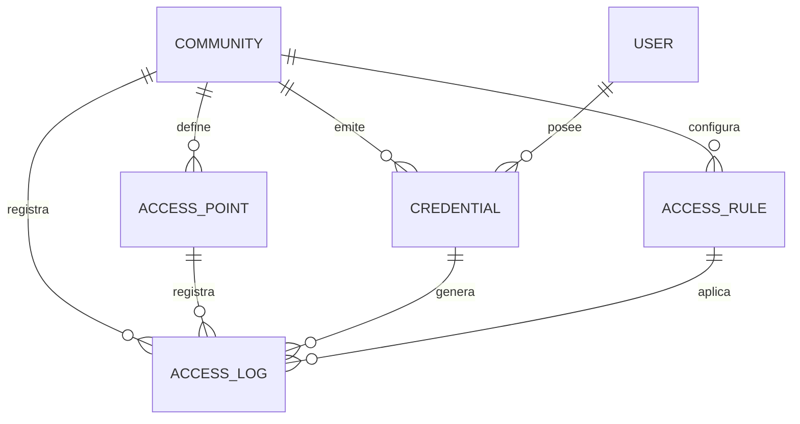

## Context

El acceso físico actual depende del kiosco y del relé. `access_codes` no tiene servicio
ni rutas y no existe una evaluación central de permisos. La fundación de dominio
(`establish-domain-foundation`) ya define `organization → community → building → unit`
y membresías con rol por alcance. Sobre esa base, este change introduce el motor de
control de acceso que usarán QR, biometría, PIN, RFID y patentes.

Restricciones: Fastify + Drizzle, multi-tenant por organización, despliegue con
PostgreSQL y MQTT. Los dispositivos pueden no tener internet, por lo que la decisión
debe poder resolverse localmente.

## Goals / Non-Goals

**Goals:**

- Un único motor de decisión para todas las credenciales.
- Reglas expresivas y deterministas con deny-by-default.
- Auditoría completa e inmutable de cada decisión.
- Actuación idempotente y desacoplada del hardware.
- Política offline firmada y sincronizable.
- Contrato público estable para que QR/biometría/dispositivos se enchufen sin tocar el
  motor.

**Non-Goals:**

- No se implementa la emisión de pases QR desde la app residente.
- No se implementa enrolamiento/matching biométrico.
- No se implementa la abstracción completa de dispositivos ni el edge agent.
- No se implementa gestión de visitas, paquetes ni vehículos (solo el tipo de
  credencial).

## Decisions

### 1. Credencial única con `type` en lugar de tablas por método

**Decisión:** una tabla `credentials` con `type` (`qr`, `pin`, `rfid`, `biometric`,
`plate`), `subject_type` (`user`, `visitor`, `vehicle`), `subject_id`, referencia al
secreto (`secret_hash` o `secret_ref`), vigencia, `max_uses`, `used_count`, `status` y
`community_id`.

**Alternativas:** tablas `qr_codes`, `pins`, `rfid_cards` separadas. Se descarta porque
el motor tendría que conocer cada tabla y cada nuevo método obliga a tocar el core.

**Consecuencia:** los detalles de emisión de pases QR viven en
`add-qr-access-passes`; acá se define el contrato de la credencial.

### 2. Contrato de token QR firmado

**Decisión:** el QR es un token firmado **Ed25519** (o JWT `EdDSA`) con payload
`{ jti, credentialId, communityId, accessPointIds?, iat, exp, maxUses }`. El
dispositivo valida firma + expiración con la clave pública cacheada, sin red.

**Alternativas:** códigos estáticos en base de datos (rechazado: reutilizables y
filtrables); HMAC compartido (rechazado: la clave de verificación permitiría forjar).
Ed25519 permite verificar sin poder firmar.

**Consecuencia:** la clave privada vive solo en el servidor; la pública se distribuye en
el snapshot de política. TTL corto (30-60 s para identidad de residente; vigencia del
pase para visitas).

### 3. Deny-by-default y precedencia deny-wins

**Decisión:** si no hay una regla que permita explícitamente, la decisión es `deny`. Si
cualquier regla de denegación aplica, gana sobre las de permiso. Entre reglas de
permiso, gana la más específica (sujeto+unidad > sujeto > rol; punto específico >
comodín).

**Alternativas:** allow-by-default (peligroso); "última regla gana" (no determinista).

**Consecuencia:** cada decisión devuelve `matchedRuleId` y `reason` para auditoría.

### 4. Motor determinista y puro

**Decisión:** el núcleo de evaluación es una función pura
`evaluate(context, credential, rules, policies, now) → Decision` con tests unitarios.
El servicio solo carga datos, persiste y actúa.

**Alternativas:** lógica embebida en la ruta o en cada dispositivo. Se descarta por
duplicación y por diferencias entre edge y servidor.

### 5. Reglas con ventana horaria y zona de la comunidad

**Decisión:** las reglas guardan horarios en la zona horaria de la comunidad; el motor
convierte `now` a esa zona para evaluar. Se soportan ventanas por día de semana,
feriados opcionales y rango de fechas.

**Alternativas:** evaluar en UTC. Se descarta porque "de 8 a 18" es local, no UTC.

### 6. Usos máximos y anti-passback transaccionales

**Decisión:** `max_uses` se controla con un incremento atómico condicional
(`used_count < max_uses`). El anti-passback compara con el último `access_log` del
sujeto en el punto y dirección.

**Alternativas:** conteo en memoria (se pierde en reinicios); anti-passback global
(demasiado restrictivo).

### 7. `access_logs` operativos + eventos Timescale

**Decisión:** se persiste cada decisión en `access_logs` (tabla relacional indexada por
community, access point, subject y fecha) y además se emite un evento
`access.granted`/`access.denied` a `events` (hypertable) para analítica y bitácora.

**Alternativas:** solo eventos (consultas operativas lentas); solo `access_logs` (se
pierde la vista unificada de bitácora).

### 8. Actuación detrás de una interfaz

**Decisión:** el motor devuelve `allow` y solicita actuación a un `Actuator`. En Fase 1
el actuador llama a `POST /api/internal/relays/trigger` con `requestId`; en
`add-device-abstraction` se reemplaza por `device_commands` sin cambiar el motor.

**Alternativas:** acoplar el motor a relés/MQTT. Se descarta porque impide torniquetes,
barreras y controladoras de terceros.

### 9. Snapshot de política firmado

**Decisión:** `GET /api/internal/access/policy-snapshot` devuelve un documento firmado
(Ed25519) con `version`, `issuedAt`, `expiresAt`, reglas, credenciales vigentes
(hashes/jti), política por punto y clave pública. Un endpoint delta devuelve altas/bajas
desde `version`.

**Alternativas:** consultar todo en cada request (no escala y no funciona offline).

**Consecuencia:** el dispositivo cachea y decide; encola `access_logs` para sincronizar.

### 10. Seguridad de la API interna

**Decisión:** `X-Internal-Key` para servicios internos y un token por dispositivo para
el endpoint de verificación. Rate limiting por dispositivo y `requestId` idempotente.

**Alternativas:** confiar en la red. Se descarta en un entorno con hardware en el sitio.

## Modelo de datos

## Migration Plan

1. Crear migración `0003_access_control_engine.sql` con `credentials`,
   `access_rules`, `access_logs` y columnas `fail_policy`/`direction` en
   `access_points`.
2. Aplicar índices: `(community_id, status)`, `(subject_type, subject_id)`,
   `(community_id, created_at DESC)`, `(access_point_id, created_at DESC)`.
3. Backfill: convertir `access_codes` existentes a `credentials` tipo `qr`.
4. Desplegar API; el motor queda detrás de flag de configuración hasta cargar reglas.
5. Cargar reglas demo en el seed (una regla allow para residentes y una deny para
   ejemplo).
6. Verificar decisión allow/deny, actuación y auditoría.

**Rollback:** revertir migración y flag; las tablas nuevas no afectan el flujo anterior.

## Risks / Trade-offs

- **[Riesgo] Reglas mal configuradas bloquean accesos** → Mitigación: deny-by-default
  con simulación (`dryRun`) y validación en dashboard antes de activar.
- **[Riesgo] Revocaciones offline quedan viejas** → Mitigación: TTL corto de QR,
  snapshot con `expiresAt` y delta de revocaciones periódico.
- **[Riesgo] Anti-passback con datos incompletos tras offline** → Mitigación: el
  dispositivo encola logs y el servidor reconcilia; el anti-passback online es
  autoritativo.
- **[Trade-off] `access_logs` + eventos duplica escritura** → Costo aceptable por
  consultas operativas rápidas y analítica unificada.
- **[Trade-off] Actuador de Fase 1 acoplado a relés** → Se aísla tras interfaz para
  reemplazarlo sin tocar el motor.

## Open Questions

- ¿El anti-passback se aplica solo en accesos vehiculares o también peatonales en Fase
  1? Propuesta: configurable por punto, desactivado por defecto.
- ¿Los feriados se cargan por comunidad o se toman de un calendario global? Propuesta:
  por comunidad en Fase 2.
- ¿La simulación (`dryRun`) se expone solo a admin o también a operador? Propuesta:
  admin y community_admin.
