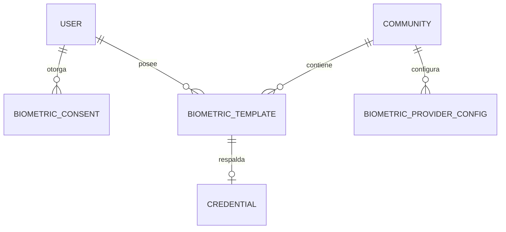

## Context

El motor de acceso (`add-access-control-engine`) ya define credenciales, reglas,
decisión, actuación y offline. La biometría entra como **un tipo de credencial**
(`biometric`) con un flujo de enrolamiento y verificación propio. No hay hardware
elegido, por lo que la prioridad es no acoplar el dominio a ningún proveedor.

Restricciones: dato sensible (Ley 1581 de Colombia, marcos equivalentes en la región),
multi-tenant, dispositivos que pueden quedar sin internet, y una experiencia que no
puede depender de la nube.

## Goals / Non-Goals

**Goals:**

- Enrolamiento con consentimiento explícito y borrado real.
- Verificación 1:1 por defecto; 1:N acotado y opt-in.
- Liveness obligatorio.
- Adaptador intercambiable edge/on-prem/cloud.
- Verificación offline con plantillas cacheadas.
- Fallback QR siempre disponible.
- Auditoría completa sin filtrar datos biométricos.

**Non-Goals:**

- No se elige hardware ni proveedor en este change.
- No se implementa el algoritmo de matching ni de liveness.
- No se cubre LPR/patentes.
- No se implementa identificación biométrica entre organizaciones.

## Decisions

### 1. La biometría es una credencial, no un módulo aparte

**Decisión:** `biometric_templates` guarda la plantilla y `credentials` tipo
`biometric` la referencia con `secret_ref`. El motor de acceso decide igual que con QR
o PIN.

**Alternativas:** un flujo de acceso paralelo solo para biometría. Se descarta porque
duplica reglas, auditoría y actuación.

### 2. Adapter-first con `BiometricProvider`

**Decisión:** interfaz con `enroll`, `verify`, `identify`, `delete`, `health`. La
implementación concreta se configura por comunidad: `edge`, `on_prem`, `cloud`.

**Alternativas:** integrar directamente un SDK de fabricante. Se descarta por lock-in y
porque no hay hardware elegido.

**Consecuencia:** el core no cambia cuando se cambia de proveedor.

### 3. 1:1 por defecto, 1:N opt-in y acotado

**Decisión:** el modo por defecto es **1:1** (el sujeto se identifica con PIN/tarjeta y
el rostro confirma). **1:N** se habilita por comunidad, con límite de galería,
umbral más estricto y liveness obligatorio.

**Alternativas:** 1:N global por defecto. Se descarta por falsos positivos, privacidad y
costo de cómputo.

**Consecuencia:** comunidades chicas pueden activar walk-up; comunidades grandes usan
1:1 o 1:N por torre.

### 4. Liveness obligatorio

**Decisión:** toda verificación exige liveness. Si falla o no está disponible, la
decisión es `deny` con reason `liveness_failed` y se ofrece QR como fallback.

**Alternativas:** liveness opcional. Se descarta porque una foto abre una puerta.

**Consecuencia:** el hardware debe soportar liveness (pasivo preferido, activo
aceptable).

### 5. Nunca imágenes crudas por defecto

**Decisión:** se guarda una plantilla/embedding cifrado o una referencia del proveedor.
Las imágenes de enrolamiento se descartan después de generar la plantilla. Si una
comunidad exige retención de imágenes para auditoría, se hace con consentimiento
separado, cifrado y retención corta.

**Alternativas:** guardar fotos para revisión manual. Se descarta por riesgo y
cumplimiento.

### 6. Consentimiento versionado y revocable

**Decisión:** `biometric_consents` registra `policy_version`, `granted_at`,
`revoked_at`, `evidence_ref` y estado. Sin consentimiento activo no se enrola ni se
verifica. Revocar el consentimiento elimina/anonimiza la plantilla.

**Alternativas:** consentimiento implícito en el alta del residente. Se descarta: es
nulo legalmente.

### 7. Umbrales por comunidad y por modo

**Decisión:** cada comunidad configura umbral de 1:1 y de 1:N, y el sistema registra
FAR/FRR estimados. Los valores se versionan con la política.

**Alternativas:** un umbral global. Se descarta porque el riesgo cambia por sitio.

### 8. Offline con plantillas cacheadas en el edge

**Decisión:** el edge cachea plantillas cifradas de su comunidad y verifica localmente.
La revocación llega por el delta de política; si el consentimiento se revoca, la
plantilla se elimina en el próximo sync y se invalida el acceso local.

**Alternativas:** verificar solo online. Se descarta por disponibilidad.

**Tradeoff:** una revocación puede tardar en propagarse; se mitiga con sync frecuente y
TTL corto.

### 9. Fallback QR obligatorio

**Decisión:** todo sujeto biométrico tiene (o puede generar) una credencial QR. Si el
proveedor falla, el liveness falla o el usuario no quiere enrolarse, el acceso sigue por
QR.

**Alternativas:** biometría como único método. Se descarta por accesibilidad, legalidad
y operación.

### 10. Auditoría sin datos sensibles

**Decisión:** se auditan eventos (`biometric.enrolled`, `biometric.consent_granted`,
`biometric.consent_revoked`, `biometric.verify_success`, `biometric.verify_failed`,
`biometric.template_deleted`) con ids y resultados, nunca embeddings ni imágenes.

## Modelo de datos

## Migration Plan

1. Crear migración `0005_biometric_access.sql` con `biometric_consents`,
   `biometric_templates` y `biometric_provider_configs`.
2. Índices por `(community_id, status)` y `(user_id)`.
3. Agregar `provider`/`mode` (`1:1`|`1:N`) a la configuración por comunidad.
4. Desplegar con la feature flag `BIOMETRIC_ENABLED=false` por defecto.
5. Configurar un proveedor `edge` de prueba y enrolar un usuario demo.
6. Verificar 1:1, liveness fallido y fallback QR.

**Rollback:** desactivar la flag, revocar consentimientos demo y revertir la migración.
Las tablas nuevas no afectan el acceso por QR.

## Risks / Trade-offs

- **[Riesgo] Falsos positivos en 1:N** → Mitigación: opt-in, límite de galería,
  umbral estricto y liveness.
- **[Riesgo] Lock-in de proveedor** → Mitigación: interfaz `BiometricProvider` y
  configuración por comunidad.
- **[Riesgo] Incumplimiento de datos sensibles** → Mitigación: consentimiento
  versionado, cifrado, borrado, retención y auditoría.
- **[Riesgo] Revocación offline tardía** → Mitigación: sync frecuente, delta firmado y
  invalidación local.
- **[Trade-off] 1:1 agrega fricción** → Se compensa con QR rápido y 1:N opt-in en
  accesos de alto tránsito.
- **[Riesgo] Hardware sin liveness** → Mitigación: el adaptador reporta capacidades y
  la comunidad no puede activar biometría si no cumple el mínimo.

## Open Questions

- ¿El enrolamiento se hace en portería con un guardia o self-service desde la app? 
  Propuesta: portería en Fase 1, self-service en Fase 2.
- ¿Se permite 1:N en el acceso principal desde el día 1? Propuesta: solo comunidades
  que lo activen explícitamente y con galería < 2.000.
- ¿Retención de imágenes para auditoría? Propuesta: desactivada por defecto.
- ¿Qué proveedor edge se usa para el piloto? Pendiente de la matriz de evaluación de
  hardware.
