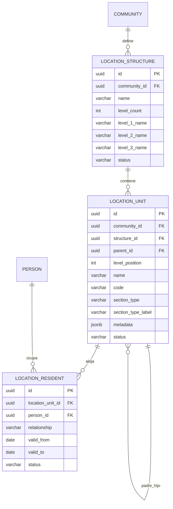

## Context

Hoy `buildings` y `units` representan una estructura fija de dos niveles. El producto
necesita estructuras configurables de hasta tres niveles, con nombres propios por
comunidad y la posibilidad de tener más de una estructura dentro de la misma comunidad.
Los residentes deben poder asociarse a una o varias ubicaciones.

## Goals / Non-Goals

**Goals:**

- Estructuras de 1 a 3 niveles con nombres personalizados.
- Varias estructuras por comunidad.
- Nodos genéricos con padre/hijo, sin tipos rígidos.
- CRUD y reestructuración sin pérdida de relaciones.
- Residentes asociados a ubicaciones.
- Migración de datos existentes.

**Non-Goals:**

- No se modifica el flujo QR en esta propuesta.
- No se separa persona/cuenta aquí.
- No se implementan subusuarios ni permisos delegados.
- No se implementa la consola administrativa por rol.

## Decisions

### 1. Los niveles se definen por estructura, no por comunidad

**Decisión:** cada comunidad puede tener una o más `location_structures`; cada estructura
define `level_count` (1–3) y los nombres de sus niveles. Así una comunidad puede tener
una estructura “Torre→Piso→Apartamento” y otra “Sector→Manzana→Local”.

**Alternativas:** niveles únicos por comunidad. Se descarta porque impide estructuras
distintas dentro de la misma comunidad.

### 2. Nodos genéricos `location_units`

**Decisión:** todos los niveles son `location_units` con `parent_id`, `level_position`,
`name`, `code`, `metadata`. No hay tablas por tipo (edificio, piso, oficina).

**Alternativas:** tablas por tipo. Se descarta por rigidez.

### 3. Semántica de unidad

**Decisión:** un nodo es una “unidad” (hoja) cuando `level_position = level_count`. Puede
tener residentes asociados. Los nodos intermedios son agrupadores.

**Alternativas:** una tabla `location_units` separada de los nodos. Se descarta para no
duplicar la jerarquía.

### 4. Restricciones de integridad

**Decisión:**
- `parent_id` debe pertenecer a la misma estructura.
- `level_position = parent.level_position + 1`.
- No se permiten ciclos.
- No se puede borrar un nodo con hijos.
- `code` es único dentro de la estructura por padre.

### 5. Cambios de estructura sin perder datos

**Decisión:**
- Renombrar niveles es seguro.
- Mover un nodo con hijos se permite dentro de la misma estructura si el nivel encaja.
- Cambiar `level_count`:
  - expandir: se agrega un nivel y los nodos existentes conservan su posición;
  - reducir: solo se permite si no hay nodos en el nivel a eliminar.

### 6. Residentes por ubicación

**Decisión:** `location_residents` (persona ↔ location_unit) con relación
`owner|tenant|resident|family|staff`, vigencia y estado. Una persona puede tener varias
ubicaciones y una ubicación varios residentes.

**Alternativas:** usar solo `memberships.unit_id`. Se descarta porque mezcla staff/roles
con ocupación y no soporta histórico.

### 7. Migración desde `buildings`/`units`

**Decisión:** por comunidad:
1. crear estructura “Estructura principal” con 3 niveles: “Sección”, “Piso”, “Unidad”;
2. cada `building` → sección (nodo nivel 1) con `section_type = 'building'`;
3. preservar `name`, `code` y `floors`; el admin puede cambiar el tipo después;
4. cada `unit` con `floor` → nodo nivel 2 “Piso {n}” (crear si falta);
5. cada `unit` → nodo nivel 3 con su código;
6. las membresías con `unit_id` se migran a `location_residents`/`location_unit_id`;
7. el `unit_id` del QR se migrará en la propuesta 7.

**Alternativas:** estructura de 2 niveles sin pisos. Se descarta para preservar el dato
`floor`.

### 8. API/UI

**Decisión:**
- `GET/POST/PATCH /api/communities/:id/location-structures`
- `GET/POST/PATCH /api/location-structures/:id/units`
- `GET /api/sections?communityId=&type=&search=&page=&pageSize=`
- `POST /api/sections` / `PATCH /api/sections/:id`
- `POST /api/location-units/:id/move`
- `POST /api/location-units/:id/residents`
- La UI muestra la estructura como árbol y permite editar nombres/niveles.
- La consola administrativa lista secciones en una tabla central con filtros por
  comunidad, tipo y estado.

### 9. Tipos semánticos en secciones

**Decisión:** los nodos intermedios no usan enums rígidos. Las secciones raíz (nivel 1)
llevan `section_type` de un catálogo fijo + `other` con `section_type_label`. El tipo no
cambia niveles ni reglas del árbol: es semántica, filtro y presentación. No se infiere
del nombre de la sección.

Catálogo inicial: `tower`, `interior`, `building`, `zone`, `block`, `sector`, `floor`,
`house`, `lot`, `commercial`, `other`.

## Modelo de datos

## Risks / Trade-offs

- **[Riesgo] Migración de datos existente** → Mitigación: script transaccional con backup
  y verificación de conteos.
- **[Riesgo] Árboles profundos/inválidos** → Mitigación: constraints y validación en
  servicio.
- **[Trade-off] Varias estructuras por comunidad** → Más flexibilidad, más complejidad de
  UI.
- **[Riesgo] QR apunta a `unit_id` viejo** → Mitigación: propuesta 7 y migración
  coordinada.

## Open Questions

- ¿Máximo 3 niveles es suficiente? Propuesta: sí, configurable 1–3.
- ¿Se permite mover un nodo entre estructuras? Propuesta: no; solo dentro de la misma
  estructura.
- ¿Los residentes sin cuenta (subusuarios) se asocian en la propuesta 6? Propuesta: sí.
