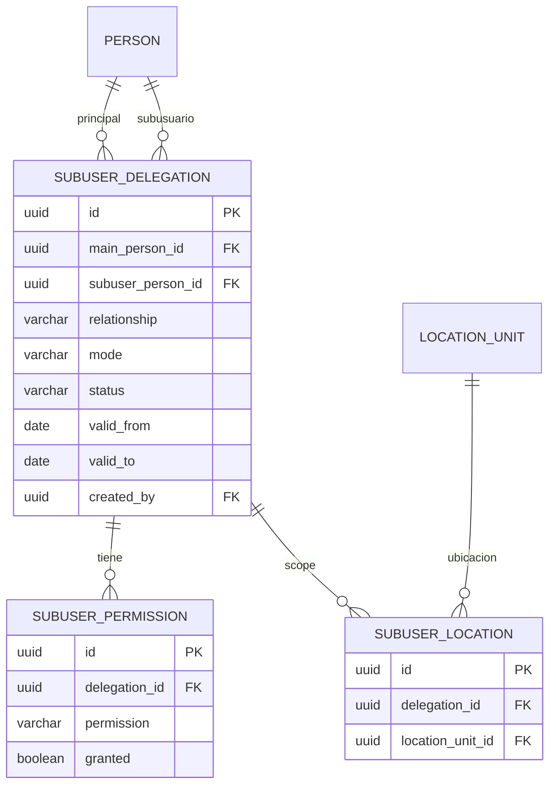

## Context

El modelo de personas/cuentas y la jerarquía administrativa permiten separar identidad de
credenciales. Falta representar la delegación dentro de una unidad: el residente
principal crea subusuarios y les permite autorizar visitantes o administrar ubicaciones,
con o sin cuenta propia.

## Goals / Non-Goals

**Goals:**

- Subusuarios gestionados sin correo.
- Subusuarios con cuenta y permisos delegados.
- Permisos acotados a ubicaciones.
- Trazabilidad individual de autorizaciones.
- Revocación inmediata de permisos.

**Non-Goals:**

- No se modifica el flujo QR (se integra en la propuesta 7).
- No se implementa la jerarquía administrativa.
- No se implementa la estructura de ubicaciones.

## Decisions

### 1. Delegación como entidad

**Decisión:** `subuser_delegations` vincula `main_person_id` con `subuser_person_id`,
relación, modo (`managed` | `account`), estado y vigencia. Un subusuario puede estar
delegado por un principal; el modelo permite futuras delegaciones múltiples.

**Alternativas:** un campo `parent_user_id` en users. Se descarta: no modela permisos ni
alcance.

### 2. Dos modalidades

**Decisión:**
- `managed`: el subusuario es una persona sin cuenta. No inicia sesión. El principal lo
  selecciona como autorizador en la app.
- `account`: el subusuario tiene cuenta propia (email). Inicia sesión y ve solo lo
  delegado.

**Alternativas:** obligar a todos a tener cuenta. Se descarta por fricción.

### 3. Permisos

**Decisión:** `subuser_permissions` con permisos:
- `authorize_visitors`
- `manage_locations`
- `view_history`

`manage_subusers` queda reservado al principal. Los permisos son acumulables y se
evalúan junto con el alcance por ubicación.

### 4. Alcance por ubicación

**Decisión:** `subuser_locations` define las ubicaciones sobre las que el subusuario
puede operar. El principal solo puede delegar ubicaciones que administra.

**Alternativas:** alcance por comunidad. Se descarta: demasiado amplio para un familiar.

### 5. Trazabilidad de autorizaciones

**Decisión:** cada pase registra:
- `created_by_person_id` (principal o subusuario);
- `authorized_by_person_id` (quien autorizó);
- `authorized_by_delegation_id` (si aplica).
La bitácora muestra el nombre del autorizador y el principal.

**Alternativas:** solo el principal. Se descarta: no hay trazabilidad individual.

### 6. Revocación

**Decisión:** revocar una delegación:
- impide crear nuevos pases;
- no invalida pases ya emitidos (quedan auditados);
- puede revocar pases pendientes según política;
- registra evento `subuser.revoked`.

### 7. Autenticación

**Decisión:** un subusuario `account` inicia sesión con su cuenta y contexto; el token
incluye su `personId` y las delegaciones activas. Un subusuario `managed` no tiene token;
el principal lo representa y el pase guarda su identidad.

### 8. UI

**Decisión:** en el modo residente:
- lista de subusuarios;
- crear/editar/revocar;
- permisos por switch;
- ubicaciones por selector;
- al crear un pase, selector de autorizador (principal o subusuario con permiso).

## Modelo de datos

## Risks / Trade-offs

- **[Riesgo] Escalada por delegación** → Mitigación: validar que el principal administre
  la ubicación y el permiso.
- **[Riesgo] Pases de subusuarios revocados** → Mitigación: política de revocación y
  auditoría.
- **[Trade-off] Subusuario sin cuenta** → No puede autenticarse; el principal lo
  representa.
- **[Riesgo] Duplicar personas** → Mitigación: reutilizar el modelo de personas.

## Open Questions

- ¿Un subusuario puede tener varias delegaciones? Propuesta: sí, con permisos por
  delegación.
- ¿Un subusuario con cuenta puede ser principal de otros? Propuesta: no en Fase 1.
- ¿Revocar una delegación invalida pases pendientes? Propuesta: sí, los pendientes; los
  usados quedan.
