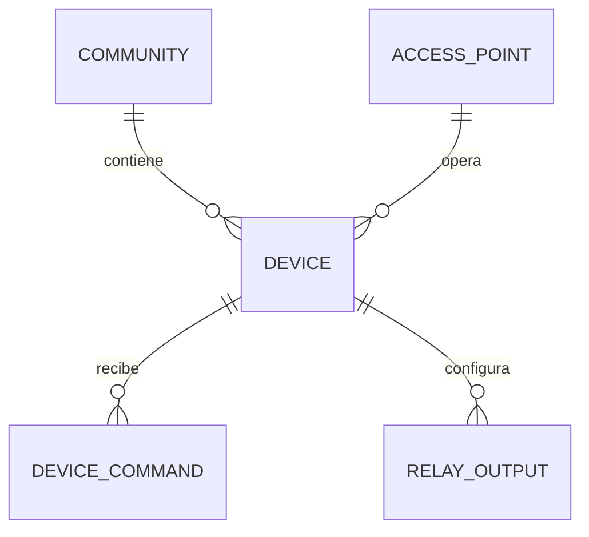

## Context

Hoy `kiosks` y `relay_outputs` son el único modelo de hardware. El motor de acceso ya
define una costura `Actuator`, pero necesita un modelo de dispositivos real para
soportar lectores, torniquetes, barreras y placas de relés. La plataforma tiene que
operar con hardware heterogéneo y con conectividad intermitente.

Restricciones: MQTT disponible, múltiples fabricantes, multi-tenant, y un agente local
que debe seguir abriendo puertas si se cae internet.

## Goals / Non-Goals

**Goals:**

- Modelo de dispositivo genérico y multi-tipo.
- Comandos idempotentes con ack, timeout y reintentos.
- Adaptadores por driver sin tocar el motor.
- Provisioning y autenticación por dispositivo.
- Agente edge con cache de política y cola de logs.
- Compatibilidad con el flujo actual de kiosco/relé.

**Non-Goals:**

- No firmware ni OTA.
- No drivers de fabricante en esta fase.
- No se implementa descubrimiento automático de hardware.
- No se reemplaza el protocolo MQTT por otro.

## Decisions

### 1. Dispositivo de primera clase

**Decisión:** `devices` con `community_id`, `access_point_id?`, `type`, `driver`,
`identifier`, `secret_ref`, `capabilities`, `status`, `last_seen_at`. Un punto de
acceso puede tener varios dispositivos.

**Alternativas:** seguir usando `kiosks` como única entidad. Se descarta porque mezcla
terminal táctil con hardware de acceso.

### 2. Tipos y drivers

**Decisión:** tipos `kiosk`, `face_reader`, `qr_reader`, `turnstile`, `barrier`,
`relay_board`, `intercom`. Cada tipo tiene un `driver` que implementa
`DeviceDriver` (`open`, `close`, `status`, `identify`, `reboot`).

**Alternativas:** un driver por fabricante desde el inicio. Se descarta por alcance; el
contrato queda preparado.

### 3. Outbox de comandos

**Decisión:** `device_commands` con `request_id` único, `payload`, `status`,
`attempts`, `available_at`, `sent_at`, `acked_at`, `last_error`. El worker reclama con
`FOR UPDATE SKIP LOCKED`, publica en MQTT y espera ack.

**Alternativas:** publicar directo a MQTT desde la ruta (pierde comandos si MQTT cae).

### 4. Idempotencia y ack

**Decisión:** cada comando lleva `requestId`; el dispositivo debe ser idempotente y
responder ack. Sin ack dentro del timeout, se reintenta; tras N intentos, `failed`.

**Alternativas:** fire-and-forget (no se sabe si la puerta abrió).

### 5. Tópicos MQTT normalizados

**Decisión:**
- Comando: `community/{communityId}/device/{deviceId}/cmd`
- Ack: `community/{communityId}/device/{deviceId}/ack`
- Estado: `community/{communityId}/device/{deviceId}/state`
- Evento: `community/{communityId}/device/{deviceId}/event`

**Alternativas:** mantener `porteria/{buildingId}/relay/{index}` como esquema principal.
Se conserva como capa de compatibilidad, pero el esquema nuevo es el oficial.

### 6. Provisioning y autenticación

**Decisión:** cada dispositivo recibe un `deviceToken` al provisionarse. El broker/API
valida el token y el `communityId`. Opcionalmente mTLS en el edge.

**Alternativas:** confiar en la red. Se descarta.

### 7. Compatibilidad con relés

**Decisión:** `relay_outputs` se mantiene como configuración hija de un dispositivo tipo
`relay_board` o `kiosk`. El `RelayActuator` del motor de acceso se reemplaza por
`DeviceActuator`, que crea un `device_command`.

**Alternativas:** eliminar `relay_outputs` de golpe. Se descarta para no romper el flujo
actual.

### 8. Edge agent

**Decisión:** proceso local (RPi/NUC) que cachea la política, mantiene plantillas
biométricas si aplica, ejecuta comandos contra el hardware y encola logs.
Se comunica con MQTT y con la API para sync.

**Alternativas:** que cada dispositivo hable directo con la nube. Se descarta por
latencia y offline.

### 9. Estado y observabilidad

**Decisión:** `devices.status` (`online`, `offline`, `degraded`, `maintenance`) y
`last_seen_at`. Un watchdog marca offline tras el heartbeat perdido.

**Alternativas:** solo logs. Se descarta para operación.

## Modelo de datos

## Migration Plan

1. Crear `devices` y `device_commands` con índices y `request_id` único.
2. Migrar cada `kiosks` a un `device` tipo `kiosk`.
3. Asociar `relay_outputs` al `device` correspondiente.
4. Mantener `buildingId` como alias temporal en MQTT; el nuevo esquema es el oficial.
5. Implementar `DeviceActuator` y activarlo con flag.
6. Verificar apertura, ack, reintento y timeout.

**Rollback:** desactivar `DeviceActuator`, volver a `RelayActuator`; las tablas nuevas
quedan sin uso.

## Risks / Trade-offs

- **[Riesgo] Dispositivos sin ack confiable** → Mitigación: timeout + reintento +
  estado; el edge agent confirma localmente.
- **[Riesgo] Migración de relés rompe el flujo** → Mitigación: flag y compatibilidad.
- **[Riesgo] Seguridad de dispositivos** → Mitigación: token por dispositivo, rotación y
  scopes por comunidad.
- **[Trade-off] Más tablas y workers** → Necesario para hardware heterogéneo.
- **[Riesgo] Tópicos MQTT inconsistentes** → Mitigación: contrato único y tests de
  integración con Mosquitto.

## Open Questions

- ¿El edge agent será un proceso Node o Python? Propuesta: Node para compartir tipos;
  Python solo si necesita GPIO/visión.
- ¿Se usa mTLS desde el inicio? Propuesta: token en Fase 1, mTLS en Fase 2.
- ¿Se soporta descubrimiento automático? Propuesta: no en esta fase.
