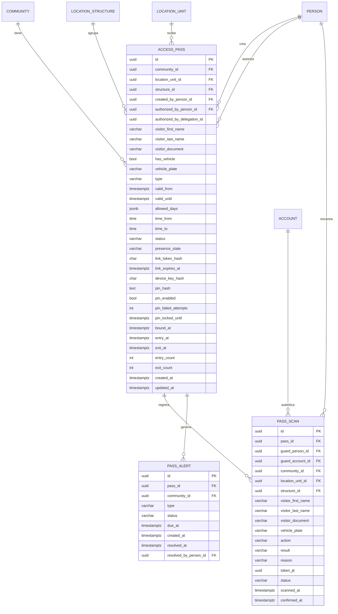
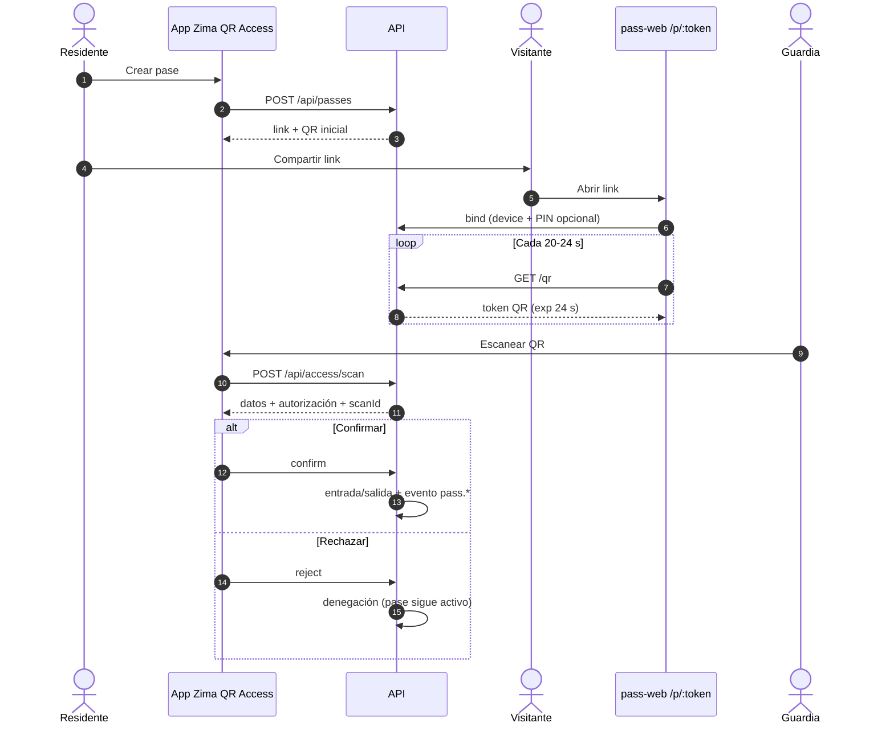

## Context

La fundación multi-tenant, las invitaciones/consola de plataforma, la jerarquía de
ubicaciones y la separación personas/cuentas ya están implementadas. El producto necesita
un primer vertical slice real: **pases de acceso dinámicos por link**. El residente los
crea desde la app, el visitante abre el link en su teléfono y el guardia escanea el QR
desde la app. No hay terminales, ni biometría, ni apertura automática de puertas.

Restricciones: multi-tenant, PII (cédula), links públicos, teléfonos con conectividad
intermitente, y un guardia que decide manualmente el acceso.

## Goals / Non-Goals

**Goals (MVP):**

- Crear pases `entry_only` y `entry_exit` para una unidad hoja de la jerarquía.
- Compartir un link que solo funcione en el primer dispositivo que lo abre.
- Mostrar un QR que rota cada 24 s y que no se pueda reutilizar.
- Permitir que el guardia confirme o rechace el ingreso.
- Registrar entrada/salida en bitácora con nombre, apellido, cédula, placa y autorizador.
- Dejar el schema y los contratos listos para push, subusuarios, recurrentes y alertas.

**Non-Goals (MVP):**

- No biometría ni terminales físicos.
- No actuación de puertas/torniquetes.
- No validación offline.
- No motor genérico de reglas/credenciales.
- No app nativa separada para el guardia (la app es `add-zima-qr-access-app`).
- No notificaciones push.
- No subusuarios/delegaciones.
- No pases recurrentes.
- No worker de salida faltante.

## Decisions

### 1. Tipos de pase y semántica

**Decisión:**

- `entry_only`: un solo ingreso. Se consume al confirmar la entrada.
- `entry_exit`: un ingreso y una salida dentro de la ventana. Al confirmar la salida,
  el pase queda `used`.
- `entry_exit_recurring`: **reservado para Phase 2**. El enum y las columnas
  (`allowed_days`, `time_from`, `time_to`) existen desde el MVP, pero la creación con ese
  tipo se rechaza con 400 hasta que la lógica de recurrencia esté implementada.

**Alternativas:** un único tipo multiuso. Se descarta porque cambia el consumo, las
alertas y la bitácora.

### 2. Link token y binding al primer dispositivo

**Decisión:** el pase guarda `link_token_hash` (SHA-256) y `device_key_hash`. El link es
`/p/<token>`. La primera apertura:

- si el pase no tiene dispositivo, vincula una cookie `pass_device` HttpOnly, `Secure` en
  producción, `SameSite=Lax`, `Path=/api/public/passes`, con `Max-Age` igual al TTL del
  link;
- si ya tiene otro dispositivo, responde 403;
- si el pase tiene PIN, exige los 4 dígitos antes de vincular.

El link expira a los `PASS_LINK_TTL_MINUTES` (1440 por defecto), con tope en
`valid_until`. Un link vencido responde 410 `link_expired`.

**Alternativas:** solo localStorage (más fácil de copiar); PIN obligatorio (más fricción).

**Consecuencia:** si el visitante pierde el teléfono, el residente regenera el link; el
dispositivo anterior queda desvinculado y el contador de intentos de PIN se resetea.

### 3. QR rotativo de 24 segundos

**Decisión:** el servidor emite un JWT HS256 firmado con `PASS_QR_SECRET`. El payload es
`{ v: 1, passId }` más los claims estándar `jti`, `iat` y `exp`, con
`exp = ahora + PASS_QR_TTL_SECONDS` (24 s). La página pide uno nuevo cada 20–24 s. El
`jti` es único y se registra en `pass_scans`; el token crudo nunca se persiste ni se
loguea.

**Alternativas:** QR estático (se comparte y no expira); TOTP local (más complejo de
sincronizar); Ed25519 (mejor para rotación de claves, pero más infraestructura para el
MVP).

### 4. Escaneo, Confirmar/Rechazar

**Decisión:** el escaneo **consume el token QR** (el `jti` no se puede repetir) y crea un
`pass_scan` en estado `pending` con TTL de `PASS_SCAN_PENDING_TTL_SECONDS` (120 s). El
guardia ve los datos y:

- **Confirmar**: en una transacción registra entrada o salida, actualiza
  `presence_state`, tiempos y contadores, y emite el evento `pass.*`.
- **Rechazar**: registra `rejected`; el pase no cambia de estado y sigue activo.

El rechazo consume el `jti`: el visitante recibe un QR nuevo en el siguiente refresco de
20–24 s. Un scan `pending` vencido pasa a `expired`; confirmarlo responde 409
`scan_expired`.

**Alternativas:** consumir el pase completo en el escaneo. Se descarta para permitir que
un rechazo no inutilice el pase.

**Consecuencia:** el pase se consume recién al confirmar, según el tipo.

### 5. Presencia y ciclos

**Decisión:** `status` (`active`, `used`, `revoked`, `expired`) y `presence_state`
(`outside`, `inside`) son campos separados. El escaneo decide la acción:

- `presence_state = outside` → entrada;
- `presence_state = inside` → salida.

La salida se permite aunque la ventana ya haya terminado, para cerrar el ciclo. Un pase
`used` no se vuelve a escanear: el scan responde denegado con razón `pass_used` y no crea
un scan pendiente.

### 6. Vehículo

**Decisión:** `has_vehicle` + `vehicle_plate` opcionales en cualquier tipo de pase. La
placa se muestra al guardia, se guarda en la bitácora y se normaliza a mayúsculas.

### 7. Salida faltante (Phase 2)

**Decisión:** la tabla `pass_alerts`, el enum `missing_exit` y
`PASS_MISSING_EXIT_GRACE_MINUTES=15` quedan definidos desde el MVP, pero **el worker no se
activa**. La detección y las notificaciones se implementan en Phase 2. En el MVP, la
bitácora muestra `presence_state = inside` para que el guardia o el admin lo vean.

### 8. Outbox con topic

**Decisión:** se agrega `outbox_events.topic` (`events` | `notifications`) desde el MVP.
El worker principal entrega solo `topic='events'`. El worker de notificaciones y los
eventos `notification.requested` quedan para Phase 2. Los eventos `pass.*` van con topic
`events`.

**Alternativas:** filtrar por nombre de evento. Se descarta por acoplamiento.

### 9. Página pública en `apps/pass-web`

**Decisión:** una app Vite/React mínima para `/p/:token`, servida bajo el mismo dominio y
como path (`/p/:token`), no en un subdominio separado. No comparte bundle con el
dashboard. El path same-site mantiene la cookie de dispositivo como first-party, algo
crítico para el navegador embebido de WhatsApp.

**Alternativas:** ruta dentro del dashboard (peso y aislamiento); subdominio separado
(cookie cross-site y `SameSite=None`).

### 10. PII y visibilidad

**Decisión:** la página pública muestra nombre y cédula enmascarada. El guardia
autorizado ve nombre, apellido y cédula completa. Los logs guardan un snapshot del
visitante; el token QR nunca se persiste. La retención de pases/escaneos se define en
Phase 2.

### 11. Ubicación y autorizador

**Decisión:** el pase referencia `location_unit_id` (hoja), `structure_id`,
`created_by_person_id` y `authorized_by_person_id`. En el MVP el autorizador es el
residente principal; `authorized_by_delegation_id` queda nullable y sin FK, reservado
para `add-delegated-subusers`. La creación valida que la persona tenga una asociación
activa en `location_residents` con esa unidad. La bitácora y el preview muestran el
camino completo (`estructura → nivel → unidad`).

## Modelo de datos

## APIs

- `POST /api/passes` (residente): crea pase + link.
- `GET /api/passes` / `GET /api/passes/:id` (residente): listado/detalle.
- `POST /api/passes/:id/revoke` / `regenerate-link`.
- `GET /api/passes/:id/qr` (residente): QR dinámico para mostrar desde la app.
- `GET /api/public/passes/:token` (público): preview enmascarado + `locationPath`.
- `POST /api/public/passes/:token/bind` (público): vincula dispositivo (+PIN).
- `GET /api/public/passes/:token/qr` (público): token QR de 24 s.
- `GET /api/public/passes/:token/status` (público): estado/presencia.
- `POST /api/access/scan` (guardia/operador): escanea y crea scan pendiente.
- `POST /api/access/scans/:id/confirm` / `reject` (guardia/operador).
- `GET /api/access/scans` (guardia/operador/admin): bitácora.

## Flow

## Migration Plan

1. Crear migración con `access_passes`, `pass_scans`, `pass_alerts` y
   `outbox_events.topic` (default `events`).
2. Índices: unique `(link_token_hash)`, unique `(token_jti)`,
   `(community_id, status)`, `(location_unit_id, created_at DESC)`,
   `(pass_id, scanned_at DESC)`, `(community_id, scanned_at DESC)`,
   `(status, scanned_at)`, `(topic, status, available_at)`,
   `(valid_until) WHERE status = 'active'`.
3. Desplegar con `DYNAMIC_QR_ENABLED=false`.
4. Crear la app `apps/pass-web` y la ruta pública `/p/:token`.
5. Probar el flujo `entry_only` y `entry_exit` con datos demo.
6. Activar el flag global.

## Risks / Trade-offs

- **[Riesgo] Link reenviado antes de abrirse** → Mitigación: binding al primer
  dispositivo + PIN opcional.
- **[Riesgo] Screenshot del QR** → Mitigación: token de 24 s y un solo uso.
- **[Riesgo] Navegador embebido de WhatsApp** → Mitigación: pass-web same-site con cookie
  first-party; documentar que el link debe abrirse en el navegador del sistema si falla.
- **[Riesgo] Guardia confirma por error** → Mitigación: Confirmar/Rechazar explícito;
  rechazo no consume el pase.
- **[Trade-off] Página pública separada** → Más deploy, pero mejor rendimiento y
  aislamiento.
- **[Riesgo] PII en bitácora** → Mitigación: acceso por roles y retención en Phase 2.

## Open Questions

- Ninguna bloqueante. El PIN es 4 dígitos, la gracia es 15 min configurable y la app se
  llama Zima QR Access.
