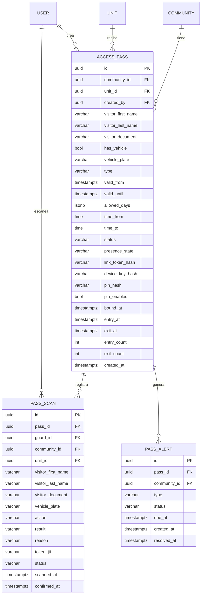

## Context

La fundación multi-tenant, las invitaciones/consola de plataforma y la outbox confiable
ya están archivadas. El producto necesita un primer vertical slice real: **pases de
acceso dinámicos por link**. El residente los crea desde la app, el visitante abre el
link en su teléfono y el guardia escanea el QR desde la app. No hay terminales, ni
biometría, ni apertura automática de puertas.

Restricciones: multi-tenant, PII (cédula), links públicos, teléfonos con conectividad
intermitente, y un guardia que decide manualmente el acceso.

## Goals / Non-Goals

**Goals:**

- Crear pases con visitante, cédula, vehículo, horario y tipo.
- Compartir un link que solo funcione en el primer dispositivo que lo abre.
- Mostrar un QR que rota cada 24 s y que no se pueda reutilizar.
- Permitir que el guardia confirme o rechace el ingreso.
- Registrar entrada/salida en bitácora con nombre, apellido, cédula, placa y autorizador.
- Alertar salidas faltantes.
- Dejar los eventos listos para notificaciones push.

**Non-Goals:**

- No biometría ni terminales físicos.
- No actuación de puertas/torniquetes.
- No validación offline.
- No motor genérico de reglas/credenciales.
- No app nativa separada para el guardia (la app es `add-zima-qr-access-app`).

## Decisions

### 1. Tipos de pase y semántica

**Decisión:**
- `entry_only`: un solo ingreso. Se consume al confirmar la entrada.
- `entry_exit`: un ingreso y una salida dentro de la ventana. Al confirmar la salida,
  el pase queda `used`.
- `entry_exit_recurring`: ciclos repetidos dentro de `valid_from`/`valid_until`, días
  permitidos y ventana diaria. Después de la salida vuelve a estar disponible para el
  próximo horario permitido.

**Alternativas:** un único tipo multiuso. Se descarta porque cambia el consumo, las
alertas y la bitácora.

### 2. Link token y binding al primer dispositivo

**Decisión:** el pase guarda `link_token_hash` (SHA-256) y `device_key_hash`. El link es
`/p/<token>`. La primera apertura:
- si el pase no tiene dispositivo, vincula una cookie HttpOnly firmada;
- si ya tiene otro dispositivo, responde 403;
- si el pase tiene PIN, exige los 4 dígitos antes de vincular.

**Alternativas:** solo localStorage (más fácil de copiar); PIN obligatorio (más fricción).

**Consecuencia:** si el visitante pierde el teléfono, el residente regenera el link; el
dispositivo anterior queda desvinculado.

### 3. QR rotativo de 24 segundos

**Decisión:** el servidor emite un token firmado (HMAC/Ed25519) con `{ passId, jti, iat,
exp }`, `exp = ahora + 24 s`. La página pide uno nuevo cada 20–24 s. El `jti` es único y
se registra en `pass_scans`; el token no se almacena.

**Alternativas:** QR estático (se comparte y no expira); TOTP local (más complejo de
sincronizar).

### 4. Escaneo, Confirmar/Rechazar

**Decisión:** el escaneo **consume el token QR** (el `jti` no se puede repetir) y crea un
`pass_scan` en estado `pending`. El guardia ve los datos y:
- **Confirmar**: en una transacción registra entrada o salida, actualiza
  `presence_state`, tiempos y contadores, y encola las notificaciones.
- **Rechazar**: registra `rejected`; el pase no cambia de estado y sigue activo.

**Alternativas:** consumir el pase completo en el escaneo. Se descarta para permitir que
un rechazo no inutilice el pase.

**Consecuencia:** el pase se consume recién al confirmar, según el tipo.

### 5. Presencia y ciclos

**Decisión:** `status` (`active`, `used`, `revoked`, `expired`) y `presence_state`
(`outside`, `inside`) son campos separados. El escaneo decide la acción:
- `presence_state = outside` → entrada;
- `presence_state = inside` → salida.

La salida se permite aunque la ventana ya haya terminado, para cerrar el ciclo y
resolver la alerta.

### 6. Vehículo

**Decisión:** `has_vehicle` + `vehicle_plate` opcionales en cualquier tipo de pase. La
placa se muestra al guardia, se guarda en la bitácora y se incluye en la notificación.

### 7. Salida faltante

**Decisión:** un worker revisa cada minuto los pases `entry_exit*` con
`presence_state = inside` y horario. Si la ventana terminó + gracia (15 min por defecto)
y no hay salida, crea `pass_alert` y encola una notificación a residente, guardia y
`community_admin`. La salida posterior resuelve la alerta.

### 8. Outbox con topic

**Decisión:** se agrega `outbox_events.topic` (`events` | `notifications`). El worker
principal entrega solo `topic='events'`. El worker de notificaciones consume
`topic='notifications'`. Los eventos `pass.*` para bitácora van con topic `events`; los
`notification.requested` van con topic `notifications`.

**Alternativas:** filtrar por nombre de evento. Se descarta por acoplamiento.

### 9. Página pública en `apps/pass-web`

**Decisión:** una app Vite/React mínima para `/p/:token`, servida bajo el mismo dominio.
No comparte bundle con el dashboard.

**Alternativas:** ruta dentro del dashboard. Se descarta por peso y aislamiento.

### 10. PII y visibilidad

**Decisión:** la página pública muestra nombre y cédula enmascarada. El guardia
autorizado ve nombre, apellido y cédula completa. Los logs guardan un snapshot del
visitante; el token QR nunca se persiste.

## Modelo de datos

## APIs

- `POST /api/passes` (residente): crea pase + link.
- `GET /api/passes` / `GET /api/passes/:id` (residente): listado/detalle.
- `POST /api/passes/:id/revoke` / `regenerate-link`.
- `GET /api/passes/:id/qr` (residente): QR dinámico para mostrar desde la app.
- `POST /api/public/passes/:token/bind` (público): vincula dispositivo (+PIN).
- `GET /api/public/passes/:token/qr` (público): token QR de 24 s.
- `GET /api/public/passes/:token/status` (público): estado/presencia.
- `POST /api/access/scan` (guardia): escanea y crea scan pendiente.
- `POST /api/access/scans/:id/confirm` / `reject` (guardia).
- `GET /api/access/scans` (guardia/admin): bitácora.

## Flow

## Migration Plan

1. Crear migración con `access_passes`, `pass_scans`, `pass_alerts` y
   `outbox_events.topic` (default `events`).
2. Índices: `(community_id, status)`, `(unit_id, created_at DESC)`,
   `(pass_id, scanned_at DESC)`, unique `(token_jti)`, `(status, available_at)`.
3. Desplegar con `DYNAMIC_QR_ENABLED=false`.
4. Crear la app `apps/pass-web` y la ruta pública.
5. Probar el flujo entry_only y entry_exit con datos demo.
6. Activar por comunidad.

## Risks / Trade-offs

- **[Riesgo] Link reenviado antes de abrirse** → Mitigación: binding al primer
  dispositivo + PIN opcional.
- **[Riesgo] Screenshot del QR** → Mitigación: token de 24 s y un solo uso.
- **[Riesgo] Guardia confirma por error** → Mitigación: Confirmar/Rechazar explícito;
  rechazo no consume el pase.
- **[Riesgo] Salida no registrada** → Mitigación: alerta con gracia configurable.
- **[Trade-off] Página pública separada** → Más deploy, pero mejor rendimiento y
  aislamiento.
- **[Riesgo] PII en bitácora** → Mitigación: acceso por roles y retención configurable.

## Open Questions

- Ninguna bloqueante. El PIN es 4 dígitos, la gracia es 15 min configurable y la app se
  llama Zima QR Access.
