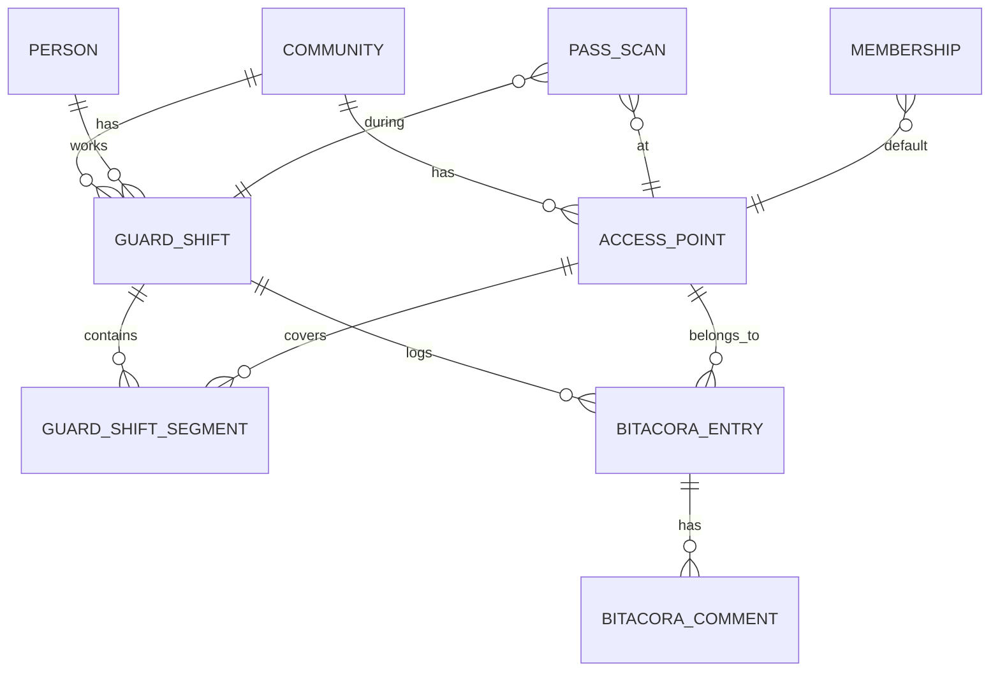

## Context

El MVP de pases dinámicos ya está implementado: creación, link público, QR rotativo,
escaneo, confirmación y rechazo. Falta el contexto físico y operativo del guardia:

- Hoy el dashboard de guardia es un placeholder.
- `pass_scans` no guarda el punto de acceso donde se validó.
- No existe turno: no hay inicio/fin, ni acceso asignado, ni historial por jornada.
- `access_points` existe con `name`, pero no hay CRUD y `gpio_pin` es obligatorio.
- La bitácora visible del dashboard lee eventos técnicos, no los accesos QR.

Restricciones: multi-tenant, PII (documento y patente), varios guardias por acceso,
cambio de portería a media jornada, bitácora inmutable y operación desde app y dashboard.

## Goals / Non-Goals

**Goals:**

- Turno personal de guardia con inicio, fin y tramos por acceso.
- Varios guardias con turno abierto en el mismo acceso.
- Acceso default asignado por el admin y cambiable por el guardia en el turno.
- Bitácora única, inmutable y por lugar físico, con comentarios.
- Registro automático desde la app y manual desde el dashboard.
- Dashboard de guardia real y vistas admin de accesos y bitácora.
- Modo guardia de Zima usando turno y punto de acceso.

**Non-Goals:**

- Operadores: sin turno, sin bitácora y sin modo guardia en Zima.
- Grants por persona/acceso: Phase 2.
- Notificaciones push, pases recurrentes, subusuarios y delegaciones.
- Edición o borrado de entradas de bitácora.
- Biometría, terminales físicos, offline y motor genérico de reglas.

## Decisions

### 1. Turno personal, no turno compartido

**Decisión:** `guard_shifts` representa el turno de una persona/cuenta. Varios turnos
pueden estar abiertos al mismo tiempo en el mismo `access_point`. No hay una entidad
"turno del acceso" compartida.

**Por qué:** cada cuenta debe registrar su propio ingreso y salida, y el admin necesita
saber qué guardias están activos en cada portería. Un turno compartido complicaría la
asistencia y el cierre individual.

**Consecuencia:** un índice parcial único garantiza un solo turno abierto por
`guard_person_id`; no hay unicidad por `access_point_id`.

### 2. Segmentos para el cambio de acceso

**Decisión:** `guard_shift_segments` guarda tramos `access_point_id` + `started_at` +
`ended_at` dentro de un turno. Al cambiar de acceso se cierra el tramo abierto y se crea
otro. Cada `pass_scan` guarda el `shift_id` y el `access_point_id` del tramo activo.

**Por qué:** el guardia puede ser enviado a otra portería a media jornada. Actualizar
solo `guard_shifts.access_point_id` perdería el historial de dónde estuvo en cada
momento.

**Consecuencia:** el cambio genera dos entradas de bitácora: `shift_end` en el acceso
viejo y `shift_start` en el nuevo, ambas con motivo `reassigned`. Así cada lugar tiene su
log completo.

### 3. La bitácora es un log inmutable, no la tabla de escaneos

**Decisión:** `bitacora_entries` es la fuente de verdad visible e inmutable. `pass_scans`
sigue siendo la máquina de estados operativa (`pending → confirmed/rejected/expired`).
Cada entrada de bitácora referencia `pass_id` y `pass_scan_id` cuando corresponde.

**Por qué:** si el escaneo pendiente se escribe en la bitácora, luego habría que
actualizarlo a confirmado o rechazado, rompiendo la inmutabilidad. La bitácora registra
acciones cerradas, no estados transitorios.

**Consecuencia:** no se escriben entradas `pending`. Se escribe al confirmar, rechazar o
denegar; también en inicio/fin de turno y entradas manuales.

### 4. Eventos que entran a la bitácora

**Decisión:**

- `pass_entry`: ingreso confirmado.
- `pass_exit`: egreso confirmado.
- `pass_rejected`: rechazo del guardia.
- `scan_denied`: pase usado, revocado, expirado, fuera de horario, token repetido,
  token inválido, comunidad incorrecta o dirección incorrecta.
- `shift_start`: inicio de turno o de un tramo.
- `shift_end`: fin de turno o cierre de un tramo.
- `manual`: novedad, paquete, incidente u observación desde el dashboard.

No se registran escaneos `pending` ni tokens crudos de QR/link. El `jti` puede guardarse
en `details` porque no es el token.

### 5. Confirmar/rechazar exige estar en turno en ese acceso

**Decisión:** cualquier guardia con un tramo abierto en el mismo `access_point` puede
confirmar o rechazar un escaneo pendiente, aunque lo haya escaneado otro. El scan guarda
`guard_person_id` (escáner) y `confirmed_by_person_id`/`confirmed_by_account_id`
(decisor). La entrada de bitácora se atribuye al decisor.

**Por qué:** hay relevos y varios guardias por portería. La actualización condicional
`pending → confirmed` ya impide dobles confirmaciones; el segundo recibe 409.

### 6. Permisos por rol + turno

**Decisión:**

- `guard`: inicia/cambia/cierra su turno; ve y crea entradas en el acceso de su tramo
  abierto; comenta en esas entradas; ve su historial de turnos.
- `community_admin`: ve toda su comunidad, crea entradas manuales, comenta, administra
  accesos y puede forzar el cierre de turnos.
- `org_admin`: igual que `community_admin`, en toda su organización.
- `platform admin`: solo lectura, con `communityId` explícito.
- `operator` y `resident`: sin acceso a turnos ni bitácora.
- **Phase 2:** `bitacora_grants` para habilitar personas/accesos específicos.

**Consecuencia:** en el MVP, "el admin da acceso" se traduce en asignar el acceso default
a la membresía y organizar los turnos. La tabla de grants queda para Phase 2.

### 7. Acceso default en la membresía

**Decisión:** `memberships.default_access_point_id` nullable. El admin lo asigna al
guardia. Al iniciar turno, la app propone ese acceso; el guardia puede cambiarlo (antes o
durante el turno). Si no hay default, el guardia elige uno de los accesos activos de su
comunidad.

**Por qué:** el guardia debe tener una portería asignada al loguearse, pero también debe
poder cubrir otra si lo reasignan.

### 8. Puntos de acceso nombrados

**Decisión:** `access_points` ya tiene `name`, `type`, `direction`, `fail_policy` y
`gpio_pin`. Se agrega `active` (default true), se vuelve `gpio_pin` nullable y se agrega
un índice único `(community_id, name)`. El CRUD lo hacen `community_admin`/`org_admin`;
el guardia solo lista activos y selecciona.

**Por qué:** una comunidad puede tener una o más porterías/portones y hay que nombrarlos
para saber dónde se validó. No todas las porterías tienen GPIO.

**Consecuencia:** el borrado es lógico (`active = false`) cuando hay historial. El FK de
`bitacora_entries.access_point_id` es `restrict` para no perder el lugar.

### 9. Operadores fuera de alcance

**Decisión:** el escaneo queda solo para `guard`. `operator` sigue con llamadas,
monitoreo y su panel actual. En Zima, `operator` cae en `no-mode`.

**Por qué:** el operador tiene otra función en la central de monitoreo. Si más adelante
escanea, se le agrega turno y listo.

**Consecuencia:** `POST /api/access/scan`, `confirm` y `reject` pasan a
`requireRole('guard')`. Los specs de QR y Zima se actualizan.

### 10. Bitácora de accesos vs Auditoría

**Decisión:** la página actual de eventos técnicos pasa a llamarse **Auditoría**. Se
agrega **Bitácora de accesos**, que lee `bitacora_entries` por comunidad y acceso.

**Por qué:** una sola fuente para la bitácora de accesos; los eventos técnicos siguen
existiendo para diagnóstico y otros dominios.

## Data Model

### `access_points` (modificada)

`id`, `name`, `type` (`door`/`gate`/`turnstile`), `gpio_pin` nullable, `community_id`,
`fail_policy`, `direction` (`entry`/`exit`/`both`), `active`, timestamps. Índice único
`(community_id, name)`.

### `memberships` (modificada)

Agrega `default_access_point_id` nullable, FK `access_points` `set null`.

### `guard_shifts`

`id`, `community_id`, `guard_person_id`, `guard_account_id` nullable, `status`
(`open`/`closed`), `started_at`, `ended_at` nullable, `ended_by_person_id` nullable,
`closed_reason` nullable (`manual`, `reassigned`, `forced`, `stale`), `created_at`,
`updated_at`. Índice parcial único `guard_person_id WHERE status = 'open'`; índices
`(community_id, status)` y `(guard_person_id, started_at DESC)`.

### `guard_shift_segments`

`id`, `shift_id`, `access_point_id`, `started_at`, `ended_at` nullable, `end_reason`
nullable (`reassigned`, `shift_end`, `forced`, `stale`), `created_at`. Índice parcial
único `shift_id WHERE ended_at IS NULL`; índices `(access_point_id, started_at DESC)` y
`(shift_id, started_at)`.

### `bitacora_entries`

`id`, `community_id`, `access_point_id`, `access_point_name` (snapshot), `shift_id`
nullable, `type`, `source` (`app`/`dashboard`/`system`), `author_person_id` nullable,
`author_account_id` nullable, `pass_id` nullable, `pass_scan_id` nullable, `summary`,
`details` jsonb, `created_at`. Sin `updated_at`. Índices
`(community_id, access_point_id, created_at DESC)`, `(shift_id, created_at DESC)`,
`(pass_id)` y `(type, created_at DESC)`.

### `bitacora_comments`

`id`, `entry_id`, `author_person_id` nullable, `author_account_id` nullable, `body`,
`created_at`. Índice `(entry_id, created_at)`. Sin edición.

### `pass_scans` (modificada)

Agrega `shift_id` nullable, `access_point_id` nullable, `access_point_name` nullable
(snapshot), `confirmed_by_person_id` nullable y `confirmed_by_account_id` nullable.

### Inmutabilidad

- No hay rutas `PATCH`/`DELETE` sobre entradas ni comentarios.
- Trigger `BEFORE UPDATE` en `bitacora_entries` y `bitacora_comments` que lanza excepción.
- `DELETE` se permite solo por cascada de comunidad/retención; no se expone por API.

## API

- `GET /api/communities/:communityId/access-points` (guardia: activos; admin: todos).
- `POST/PATCH/DELETE /api/communities/:communityId/access-points` (admin).
- `GET /api/guard/shifts/current`.
- `POST /api/guard/shifts/start` `{ accessPointId? }`.
- `POST /api/guard/shifts/:id/change-access-point` `{ accessPointId }`.
- `POST /api/guard/shifts/:id/end`.
- `POST /api/guard/shifts/:id/force-close` `{ reason }` (admin).
- `GET /api/guard/shifts` (propio; admin filtra por comunidad/acceso).
- `GET /api/bitacora` con `communityId`, `accessPointId`, `shiftId`, `from`, `to`, `type`,
  `page`, `pageSize`.
- `GET /api/bitacora/:id`.
- `POST /api/bitacora` `{ accessPointId, summary, details? }` (manual).
- `POST /api/bitacora/:id/comments` `{ body }`.
- `POST /api/access/scan` exige turno abierto; devuelve `accessPointId`,
  `accessPointName`, `shiftId`.
- `POST /api/access/scans/:id/confirm|reject` devuelve `bitacoraEntryId`.

## Dashboard

- `/guard`: datos personales, turno actual, iniciar/cambiar/cerrar turno, bitácora del
  acceso, entrada manual y comentarios.
- `/admin/access-points`: CRUD de porterías.
- `/analysis/bitacora-accesos`: Bitácora de accesos por comunidad/acceso.
- `/analysis/auditoria`: la página actual de eventos, renombrada.
- Sidebar: "Guardia", "Accesos" y "Bitácora de accesos"/"Auditoría".

## Zima (modo guardia)

- Al loguear: `GET /api/guard/shifts/current`.
- Sin turno: selector de acceso activo (default preseleccionado) e iniciar.
- Con turno: acceso actual, cambiar acceso, cerrar turno.
- Escanear con cámara o token manual; resultado con nombre del acceso; confirmar/rechazar.
- Historial del turno y de turnos anteriores.
- `operator` cae en `no-mode`.

## Risks / Trade-offs

- **Turno olvidado:** queda abierto. Mitigación: `current`, cierre manual y cierre forzado
  por admin; `GUARD_SHIFT_MAX_HOURS` para marcar turnos viejos.
- **Dos guardias confirman:** la actualización condicional resuelve; el segundo recibe 409.
- **Inmutabilidad vs. tests:** trigger solo para `UPDATE`; limpieza por cascada.
- **PII:** documento y patente en `details`; lista enmascarada, detalle completo solo para
  roles autorizados. Sin tokens crudos en logs ni en bitácora.
- **Renombre de Bitácora a Auditoría:** toca sidebar, rutas y tests de navegación.
- **`gpio_pin` nullable:** no afecta filas existentes; las porterías sin GPIO quedan
  válidas para QR.
- **Acceso default:** si la membresía no lo tiene, el guardia debe elegir al iniciar.

## Migration Plan

1. Agregar `active` y volver nullable `gpio_pin` en `access_points`; índice único
   `(community_id, name)`.
2. Agregar `memberships.default_access_point_id`.
3. Crear `guard_shifts`, `guard_shift_segments`, `bitacora_entries`, `bitacora_comments`.
4. Agregar columnas a `pass_scans`.
5. Crear el trigger de inmutabilidad.
6. No hay backfill de turnos ni bitácora; las tablas arrancan vacías.
7. Rollback: drop de tablas nuevas y columnas agregadas; las columnas existentes no se
   borran.
