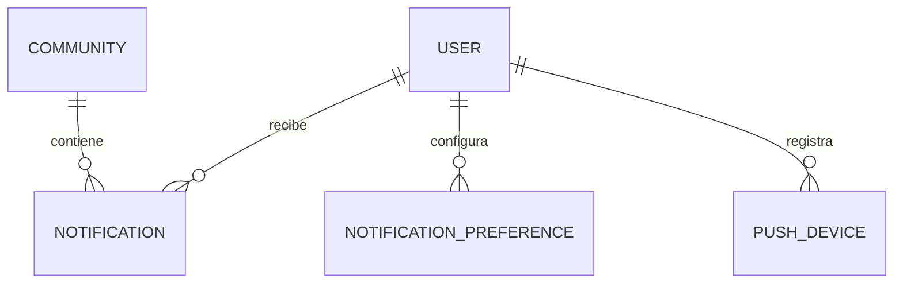

## Context

No hay canal de notificaciones. Los módulos de acceso, pánico, visitas, paquetería y
comunicaciones necesitan avisar a residentes, guardias y administradores. La outbox ya
garantiza entrega asíncrona confiable, y signaling puede entregar in-app en tiempo real.

Restricciones: multi-tenant, usuarios con varios dispositivos, preferencias por
comunidad, y datos sensibles que no deben viajar en el payload de push.

## Goals / Non-Goals

**Goals:**

- Un único servicio de notificaciones para todos los módulos.
- Entrega in-app garantizada y push best-effort con reintentos.
- Preferencias y horarios de silencio.
- Deduplicación y rate limiting.
- Plantillas i18n y payloads mínimos.
- Registro y limpieza de tokens de dispositivo.

**Non-Goals:**

- No email/SMS en esta fase.
- No campañas masivas ni segmentación avanzada.
- No constructor visual de plantillas.
- No se implementa el contenido de cada módulo (pánico, visitas); solo el canal.

## Decisions

### 1. La notificación se solicita por outbox

**Decisión:** los módulos escriben `notification.requested` en la outbox. Un worker
resuelve preferencias, renderiza la plantilla y entrega por los canales habilitados.

**Alternativas:** enviar sincrónicamente desde el request de negocio (agrega latencia y
pierde notificaciones si falla el push).

### 2. In-app es la fuente de verdad

**Decisión:** toda notificación se persiste en `notifications` antes de intentar push.
El centro in-app siempre la muestra, aun si el push falla.

**Alternativas:** solo push (se pierde el historial y no hay read receipts).

### 3. Push detrás de `PushProvider`

**Decisión:** interfaz `PushProvider` (`send`, `validateToken`, `health`). Adaptadores:
WebPush, FCM y APNs. La comunidad/usuario configura qué proveedor aplica.

**Alternativas:** acoplar a FCM. Se descarta por soporte de PWA y multiplataforma.

### 4. Payload mínimo y sin datos sensibles

**Decisión:** el push lleva `notificationId`, `type`, título genérico y un deep link. La
app consulta el detalle autenticada. Nunca se envía nombre de visitante, ubicación ni
datos biométricos.

**Alternativas:** enviar el contenido completo (riesgo de privacidad en pantalla
bloqueada).

### 5. Deduplicación por clave

**Decisión:** `dedupKey = type + recipientId + resourceType + resourceId + ventana`.
Si ya existe una notificación no leída con la misma clave en la ventana, no se duplica.

**Alternativas:** deduplicar solo por tipo (demasiado agresivo).

### 6. Preferencias y horarios de silencio

**Decisión:** preferencias por `(userId, communityId, type, channel)` con defaults por
rol. El horario de silencio suprime push pero no in-app, salvo tipos críticos (pánico)
que siempre se entregan.

**Alternativas:** sin preferencias (fricción y fatiga de notificaciones).

### 7. Entrega in-app en tiempo real

**Decisión:** el worker emite por Socket.io a la room `user:{id}`; si el usuario está
offline, queda en `notifications` y se entrega al reconectar.

**Alternativas:** polling (latencia y carga).

### 8. Ciclo de vida de tokens

**Decisión:** `push_devices` con `userId`, `platform`, `token`, `lastSeenAt`, `status`.
Un token inválido devuelto por el proveedor se marca `invalid` y se deja de usar.

**Alternativas:** un token por usuario (rompe multi-dispositivo).

### 9. Reintentos vía outbox

**Decisión:** el envío push usa la outbox con reintentos y dead-letter. El historial
in-app se escribe una sola vez.

**Alternativas:** reintentos en memoria del worker (se pierden al reiniciar).

### 10. Expo Push para la app móvil

**Decisión:** `PushProvider` incluye un `ExpoPushProvider`. La app Zima QR Access obtiene
un `ExponentPushToken[...]` y lo registra con `platform = 'expo'`. WebPush queda para
PWA; FCM/APNs para builds nativos directos si se necesitan.

### 11. Ruteo por topic del outbox

**Decisión:** `outbox_events.topic` (`events` | `notifications`). El worker principal
entrega `events`; el worker de notificaciones consume `notifications`. Ambos usan
`FOR UPDATE SKIP LOCKED`. La columna se introduce en `add-dynamic-qr-access`; este change
consume `topic = 'notifications'`.

### 12. Notificaciones de pases

**Decisión:** el servicio de pases encola `notification.requested` con tipo y datos.
Plantillas:
- `pass_entry`: “Ingresó {visitante}” + placa si hay.
- `pass_exit`: “Salió {visitante}”.
- `pass_rejected`: “Ingreso rechazado”.
- `pass_missing_exit`: “Salida pendiente de {visitante}”.
- `vehicle_entry`: “Ingresó el vehículo {placa}”.

Destinatarios: residente creador; la salida faltante además notifica a guardia y
`community_admin`. Deep link al pase.

Payload de push: nombre y placa permitidos para el residente; nunca cédula ni datos
biométricos.

### 13. Alerta de salida faltante

**Decisión:** el worker de pases crea `pass_alert` y encola la notificación; el
notification service solo entrega. La gracia (15 min por defecto) la maneja el worker
de pases. `pass_missing_exit` es crítico: ignora silencio y rate limits no críticos.

## Modelo de datos

## Migration Plan

1. Crear migración con `notifications`, `notification_preferences`, `push_devices`.
2. Índices: `(user_id, read_at, created_at DESC)`, `(dedup_key)`, `(user_id, status)`.
3. Desplegar con `NOTIFICATIONS_ENABLED=false`.
4. Registrar un `PushProvider` de desarrollo (log-only) y probar in-app.
5. Activar push por comunidad.
6. Verificar dedup, preferencias y silencio.

**Rollback:** desactivar la flag; las tablas quedan sin uso. El in-app puede seguir
funcionando aunque el push esté deshabilitado.

## Risks / Trade-offs

- **[Riesgo] Fatiga de notificaciones** → Mitigación: preferencias, dedup, rate limits y
  silencio.
- **[Riesgo] Tokens inválidos acumulados** → Mitigación: limpieza al recibir errores del
  proveedor y job periódico.
- **[Riesgo] Privacidad en pantalla bloqueada** → Mitigación: payload mínimo.
- **[Trade-off] Push best-effort** → Se acepta: in-app es la fuente de verdad.
- **[Riesgo] Pánico suprimido por silencio** → Mitigación: los tipos críticos ignoran el
  silencio y tienen su propio rate limit.

## Open Questions

- ¿Se permite que el usuario desactive pánico? Propuesta: no, solo el canal push; in-app
  siempre.
- ¿Email en Fase 2 o 3? Propuesta: Fase 3, detrás de la misma interfaz.
- ¿Notificaciones por comunidad o por organización? Propuesta: por comunidad, con
  defaults heredados de la organización.
