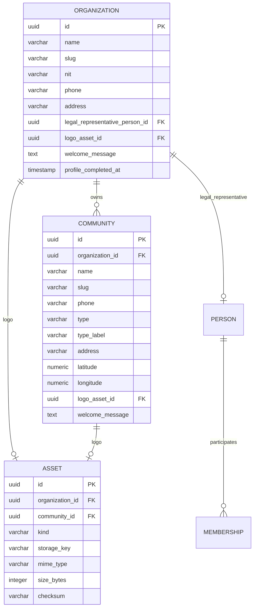

## Context

The organization is the tenant root, but today it only has `name` and `slug`.
Communities have `name`, `address`, `timezone`, organization and status. The platform
console can create these records, but the organization administrator has no place to
complete the tenant profile.

The final hierarchy is:

```text
Organization
  -> Community
       -> Location root (section)
            -> optional level 2
                 -> Location leaf (unit)
```

The last location level is always the unit. A two-level structure is valid:
`Torre -> Apartamento`; the floor can be encoded in the unit code.

## Goals / Non-Goals

**Goals:**

- Store organization profile data once and expose it to superadmin as read-only.
- Store community profile data, including type and coordinates.
- Allow organization and community logos with a safe default fallback.
- Keep logo storage behind an adapter.
- Keep profile editing scoped to the organization administrator.
- Audit profile and asset changes.

**Non-Goals:**

- No visual map implementation. Store coordinates only.
- No domain-specific NIT validation or check digit.
- No automatic image cropping or forced square dimensions.
- No superadmin profile editing.
- No community creation by community administrators.

## Decisions

### 1. NIT is nullable and uniquely indexed when present

`organizations.nit` is `varchar(30)`, nullable, normalized to digits before storage. It
does not include a check digit. A partial unique index enforces uniqueness only for
non-null values.

**Alternative:** required NIT at organization creation. Rejected because the superadmin
only creates name, slug and the administrator email.

### 2. Organization administrator is derived, not duplicated

The organization profile read model resolves the active membership with role
`org_admin` and joins its person. Pending invitations are shown as an invitation state,
not as an administrator name.

### 3. Legal representative is a person

`organizations.legal_representative_person_id` references `people`. The person may have
no account. This allows a legal representative who does not log in.

### 4. Community type is a fixed catalog plus a custom label

Allowed values:

```text
conjunto | condominio | club | hotel | edificio | otro
```

`type_label` is required when `type = otro` and is shown in the UI. The stored enum is
stable; the custom label is presentation metadata.

### 5. Address and coordinates are separate fields

`address` is a human-readable street address. `latitude` and `longitude` are optional
numeric coordinates for a future map. They are not derived from each other.

### 6. Logo assets

`assets` stores metadata and a storage key. The binary is stored by an adapter:

- development: local filesystem outside the database;
- production: S3-compatible object storage.

Validation:

- MIME: `image/png`, `image/jpeg`, `image/webp`;
- maximum size: 500 KB;
- square image is recommended in UI copy but not enforced;
- replacement deletes or deactivates the previous logo.

### 7. Profile authorization

- `org_admin`: read/update own organization profile.
- `org_admin`: read/update communities in own organization.
- `community_admin`: read/update assigned community profile.
- `superadmin`: read-only for profiles, communities, sections and units.
- `guard` / `operator`: read-only community data.

### 8. Welcome messages

Both organization and community have optional `welcome_message`. Organization welcome is
shown on the organization home; community welcome is shown on the community overview.

## Data Model



## API

```text
GET   /api/organizations/me
PATCH /api/organizations/me
GET   /api/organizations/me/communities
POST  /api/organizations/me/communities
GET   /api/communities/:id/overview
PATCH /api/communities/:id
POST  /api/assets
GET   /api/assets/:id
```

The platform read model is part of `add-admin-hierarchy-views`.

## Risks / Trade-offs

- **[Risk] NIT uniqueness with dirty input** -> normalize before compare; partial unique
  index; return 409.
- **[Risk] Orphan assets** -> replace in a transaction and delete the previous object
  after the new row is committed.
- **[Risk] Large uploads** -> enforce 500 KB before storage; never buffer unbounded data.
- **[Risk] Community type drift** -> enum plus controlled catalog; custom text only for
  `otro`.

## Migration Plan

1. Add organization/community profile columns.
2. Add `assets` and FK columns.
3. Add partial unique index for NIT.
4. Backfill existing organizations/communities with null profile values.
5. Add/verify `people` and legal representative relation after the people migration.
6. Seed a default organization/community logo only in development if needed.

## Open Questions

None blocking. The storage adapter implementation can be chosen during implementation.
