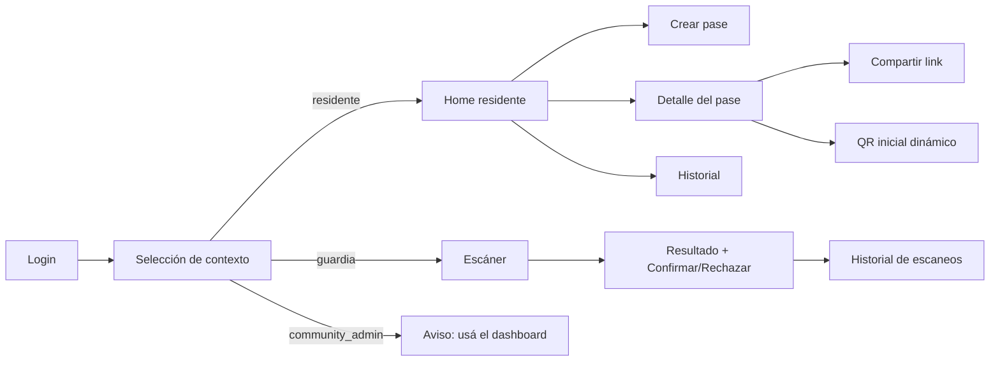

## Context

La API de pases dinámicos está especificada en `add-dynamic-qr-access`. Falta el cliente
móvil que usan residentes y guardias. La app anterior (`apps/resident`) es solo un stub
PWA. Se adopta Expo para Android/iOS por velocidad, cámara, push (Phase 2) y OTA.

Restricciones: monorepo pnpm, multi-tenant, dos roles en una misma app, cámara requiere
builds de desarrollo en dispositivos reales.

## Goals / Non-Goals

**Goals (MVP):**

- Una sola app con modo residente y modo guardia.
- Login y contexto reutilizando la API existente.
- Crear/compartir pases y mostrar el QR inicial dinámico.
- Escanear, confirmar y rechazar ingresos.
- Configuración simple para desarrollo y producción.
- Distribución Android por APK interno.

**Non-Goals:**

- No admin/operador avanzado.
- No modo `community_admin`.
- No biometría.
- No pagos.
- No modo offline.
- No escaneo desde el dashboard.
- No push en el MVP.
- No pases recurrentes en el MVP.

## Decisions

### 1. Expo + Expo Router

**Decisión:** app Expo con Expo Router, TypeScript y React Native. Nombre visible
**Zima QR Access**; slug `zima-qr-access`.

**Alternativas:** React Native bare (más setup), Flutter (fuera del stack).

### 2. Monorepo y tipos compartidos

**Decisión:** `apps/zima-qr-access` dentro del workspace pnpm, con Metro configurado
para resolver `@porteria/shared` y el resto de los paquetes del workspace.

**Alternativas:** app separada con tipos duplicados. Se descarta para mantener los DTOs
sincronizados.

**Consecuencia:** hay que configurar `watchFolders` y `nodeModulesPaths` en
`metro.config.js`; probar en un dispositivo real desde el principio.

### 3. Una app, dos modos

**Decisión:** después del login y la selección de contexto, la app decide el modo según
el rol de la membresía activa:

- `owner`, `tenant`, `resident` → modo residente;
- `guard` → modo guardia;
- `operator` y `community_admin` → sin modo en la app; se muestra un aviso para usar el
  dashboard o la central de monitoreo;
- si hay membresías mixtas, se permite cambiar de modo desde el selector de contexto.

**Alternativas:** dos apps separadas. Se descarta por simplicidad de distribución.

### 4. Autenticación y almacenamiento

**Decisión:** tokens en `expo-secure-store`; refresh automático; logout limpia tokens.
La selección de contexto reutiliza `POST /api/auth/context`.

### 5. Creación de pase

**Decisión:** formulario con `locationUnitId` (desde las membresías activas), nombre,
apellido, cédula, vehículo + placa, PIN opcional de 4 dígitos, tipo `entry_only` o
`entry_exit`, fechas y ventana diaria opcional. Validación local + errores de API.

El selector de unidad muestra el `locationPath` (estructura → nivel → unidad) y envía
`locationUnitId`. No se ofrece `entry_exit_recurring` en el MVP; el tipo queda reservado
para Phase 2. `allowedDays` no se muestra en el MVP.

### 6. QR inicial y compartir

**Decisión:** al crear el pase, la app llama `GET /api/passes/:id/qr` y muestra el QR
dinámico con un contador de 24 s. El botón **Compartir** usa `Share.share` con el link
`/p/:token`. La app no comparte la imagen del QR, comparte el link.

**Alternativas:** compartir una imagen del QR (estática; no sirve para el flujo
dinámico).

### 7. Escáner del guardia

**Decisión:** `expo-camera` con `CameraView` y barcode scanner. Al leer, llama
`POST /api/access/scan`, muestra los datos (incluido `locationPath`) y ofrece
**Confirmar** / **Rechazar**. La cámara requiere permiso explícito y HTTPS en producción.
Incluye entrada manual de token para pruebas.

### 8. Notificaciones (Phase 2)

**Decisión:** `expo-notifications` queda para Phase 2, cuando
`add-notification-service` esté implementado. En el MVP, la app muestra el estado del
pase y el historial de escaneos, sin push ni deep links.

**Alternativas:** FCM/APNs directo (más setup por plataforma).

**Consecuencia:** el MVP no requiere credenciales de Expo/FCM/APNs ni development build
para push; sí requiere development build para cámara en producción.

### 9. Configuración de entorno

**Decisión:** `EXPO_PUBLIC_API_URL` y `EXPO_PUBLIC_ENV`. En desarrollo se usa la IP LAN
del servidor, no `localhost`, para probar en un teléfono físico.

### 10. Sin offline

**Decisión:** la app requiere conectividad. Si falla la red, muestra error y permite
reintentar; no cachea pases ni QRs.

### 11. Distribución

**Decisión:** Android por APK interno primero. iOS/TestFlight después. La app no se
publica en stores durante el MVP.

## Pantallas

## Migration Plan

1. Scaffold Expo en `apps/zima-qr-access`.
2. Configurar pnpm/Metro y shared types.
3. Implementar auth + contexto.
4. Implementar modo residente (crear, QR, compartir, historial).
5. Implementar modo guardia (scanner, confirmar/rechazar, historial).
6. Generar APK interno y probar en Android.
7. Phase 2: push, deep links y notificaciones; iOS/TestFlight.

## Risks / Trade-offs

- **[Riesgo] Metro + pnpm workspace** → Mitigación: configurar `watchFolders` y probar
  temprano en dispositivo.
- **[Riesgo] Cámara en iOS/Android** → Mitigación: permisos y fallback de entrada manual
  de token para pruebas.
- **[Trade-off] Una app para dos roles** → Menos apps, pero navegación por rol más
  compleja.
- **[Riesgo] URL de API en dispositivo físico** → Mitigación: `EXPO_PUBLIC_API_URL` con
  IP LAN y documentación.
- **[Riesgo] `community_admin` sin modo** → Mitigación: aviso explícito y uso del
  dashboard.

## Open Questions

- Ninguna bloqueante. El nombre es Zima QR Access y el modo guardia vive en la misma app.
