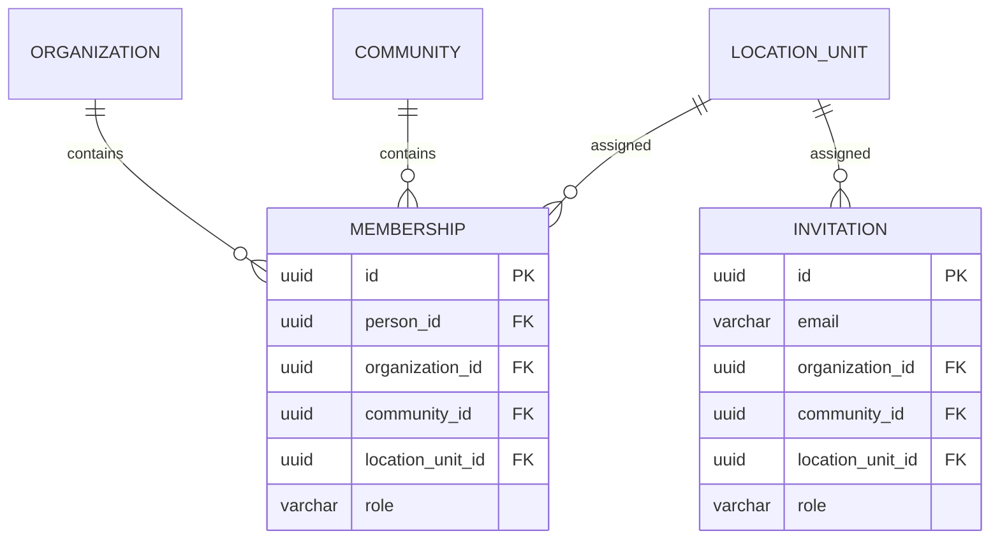

## Context

The project currently has two unit concepts:

```text
units
  id, community_id, building_id, code, floor, type

location_units
  id, community_id, structure_id, parent_id, level_position, code
```

The configurable hierarchy uses `location_units`. Memberships and invitations still use
`unit_id` from the legacy `units` table. This can produce mismatched resident scopes.

## Goals / Non-Goals

**Goals:**

- One authoritative unit reference for memberships/invitations.
- Leaf-only assignment.
- Community and organization scope enforcement.
- Safe migration of existing data.
- Tests for all occupant roles and invitation flows.

**Non-Goals:**

- No QR pass implementation.
- No removal of the legacy `units` table in this change.
- No change to the location hierarchy levels.

## Decisions

### 1. Location unit is the assignment target

Use:

```text
memberships.location_unit_id -> location_units.id
invitations.location_unit_id -> location_units.id
```

The legacy `unit_id` becomes deprecated and is kept only for migration compatibility.

### 2. Leaf validation is mandatory

A location unit is assignable only when:

```text
location_unit.level_position = structure.level_count
```

It must belong to the same community as the membership/invitation.

Sections, floors and intermediate nodes are rejected with `400`.

### 3. Role scope

```text
owner / tenant / resident: location_unit_id required
community_admin / operator / guard: community_id required, location optional/null
org_admin: organization_id required, community and location null
```

### 4. Migration

1. Add new nullable columns.
2. Backfill from legacy `units` using community + code mapping.
3. Keep unresolved rows for manual review.
4. Add non-null check for occupant roles in application validation.
5. Keep legacy columns until the migration is verified, then remove.

### 5. API shape

Prefer `locationUnitId` in new/updated DTOs. Keep accepting `unitId` only during a
documented compatibility window, mapping it to the legacy row if possible.

## Data Model



## Risks / Trade-offs

- **[Risk] Unmatched legacy units** -> produce a migration report and keep nullable
  columns until manual cleanup.
- **[Risk] Accidentally assigning a section** -> enforce leaf validation in the service
  and database-backed tests.
- **[Risk] Old clients send `unitId`** -> compatibility mapping with deprecation warning.
- **[Risk] Resident loss** -> verify counts before/after and back up.

## Tests

- Unit: leaf predicate, scope validation, role scope.
- Integration: membership/invitation creation, cross-community rejection, migration
  mapping, resident preservation.
- Migration: counts and unresolved report.
