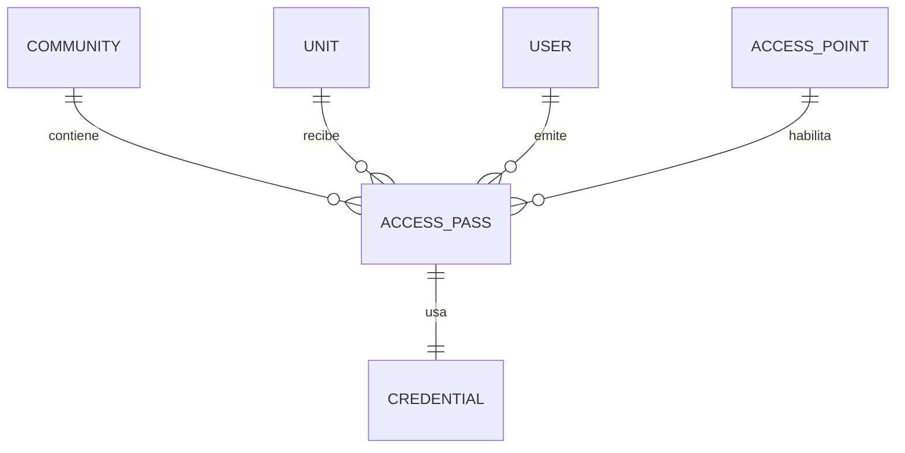

## Context

El motor de acceso (`add-access-control-engine`) ya define credenciales, tokens QR
firmados, reglas, decisión y offline. Falta la capa de negocio que permite a un
residente emitir un pase para una visita y que un dispositivo lo valide. La tabla
`access_codes` es un intento incompleto y será reemplazada.

Restricciones: multi-tenant, tokens verificables offline, revocación inmediata online y
diferida offline, y auditoría completa.

## Goals / Non-Goals

**Goals:**

- Emitir pases con vigencia, alcance y usos.
- Reutilizar el motor para validar, sin lógica duplicada.
- Token nunca almacenado en claro.
- Revocación y expiración propagadas.
- Notificación al residente cuando la visita ingresa.

**Non-Goals:**

- No se implementa gestión completa de visitantes ni paquetería.
- No se implementa la UI de la app residente.
- No se implementa biometría.
- No se implementa pago de visitas.

## Decisions

### 1. El pase posee una credencial

**Decisión:** `access_passes` tiene `credential_id` único que referencia una credencial
tipo `qr`. El pase es el objeto de negocio; la credencial es el mecanismo técnico.

**Alternativas:** guardar el token en el pase. Se descarta porque mezcla dominio con
seguridad y duplica el ciclo de vida.

### 2. El token no se almacena

**Decisión:** se guarda `jti` y estado, no el token firmado. El token se regenera bajo
demanda a partir de la credencial y la clave privada del servidor.

**Alternativas:** almacenar el token (si se filtra la DB, se pueden reusar códigos).

### 3. Tipos de pase

**Decisión:** `visitor`, `delivery`, `provider`, `frequent`, `temporary`. Cada tipo
tiene defaults de vigencia y usos, configurables por comunidad.

**Alternativas:** un único tipo genérico. Se descarta porque las reglas y notificaciones
difieren.

### 4. Alcance y permisos

**Decisión:** un residente emite solo para sus unidades; un guardia/operador puede
emitir a nombre de una unidad; un admin puede emitir en cualquier unidad de su alcance.
El pase se limita a los puntos de acceso seleccionados o a los permitidos por política.

**Alternativas:** cualquier residente emite para cualquier unidad (riesgo de seguridad).

### 5. Rate limit por unidad y día

**Decisión:** límite configurable de pases por unidad/día y de usos por pase. Se
registran intentos rechazados.

**Alternativas:** sin límite (abuso y spam de pases).

### 6. Validación reutiliza el motor

**Decisión:** el escaneo decodifica el token y llama a
`POST /api/internal/access/verify` con la credencial. No hay un camino de validación
paralelo.

**Alternativas:** validar en el endpoint de pases. Se descarta por duplicar reglas.

### 7. Revocación y offline

**Decisión:** revocar un pase revoca la credencial; online es inmediato. Offline, el
dispositivo lo aplica al recibir el delta de política o al expirar el token.

**Alternativas:** esperar la expiración natural (peligroso si se comparte un QR).

### 8. Notificación de ingreso

**Decisión:** el primer uso válido del pase emite `visitor.arrived` al residente. Usos
posteriores no repiten la notificación salvo configuración.

**Alternativas:** notificar cada uso (ruido).

### 9. Regeneración de token

**Decisión:** el residente puede regenerar el token mientras el pase esté activo; la
regeneración rota el `jti` e invalida el anterior.

**Alternativas:** token inmutable (si se filtra, no se puede cortar sin revocar el pase).

## Modelo de datos

## Migration Plan

1. Crear migración con `access_passes` e índices.
2. Backfill `access_codes` a `access_passes` + `credentials` cuando sea posible.
3. Desplegar con `QR_PASSES_ENABLED=false`.
4. Emitir un pase demo y validar en el kiosco.
5. Activar emisión para residentes de la comunidad demo.

**Rollback:** desactivar la flag y revocar pases demo; las tablas nuevas no afectan el
flujo anterior.

## Risks / Trade-offs

- **[Riesgo] Pases compartidos por captura de pantalla** → Mitigación: TTL corto,
  regeneración y usos limitados.
- **[Riesgo] Revocación offline tardía** → Mitigación: delta de política y expiración.
- **[Riesgo] Abuso de emisión** → Mitigación: rate limit por unidad/día y auditoría.
- **[Trade-off] El pase y la credencial son 1:1** → Más tablas, pero separa negocio de
  seguridad.
- **[Riesgo] Un residente emite para una unidad ajena** → Mitigación: validación de
  membresía y unidad en el servicio.

## Open Questions

- ¿Un pase puede cubrir varias unidades? Propuesta: no en Fase 1.
- ¿El guardia puede emitir sin aprobación del residente? Propuesta: sí, con auditoría y
  notificación.
- ¿Se permite pase recurrente (frequent) con horario? Propuesta: sí, con reglas.
