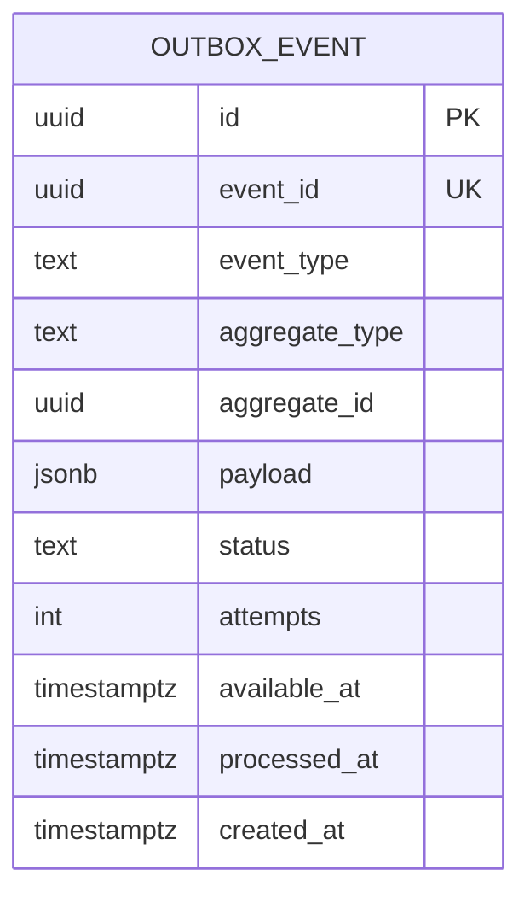

## Context

El API escribe eventos en la hypertable `events`, pero los servicios externos
(signaling, mqtt-bridge) lo hacen por HTTP y descartan errores. No hay reintentos,
deduplicación ni visibilidad de pérdidas. La fundación multi-tenant ya está definida y
los módulos de acceso y pánico van a generar eventos críticos.

Restricciones: PostgreSQL disponible, sin infraestructura de mensajería adicional,
monorepo TypeScript. Se prioriza simplicidad operativa sobre throughput extremo.

## Goals / Non-Goals

**Goals:**

- Garantizar que un evento de dominio no se pierda por una caída transitoria del API.
- Entrega at-least-once con idempotencia en el consumidor.
- Reintentos, dead-letter y replay controlado.
- Observabilidad de lag y fallos.
- Migrar signaling sin cambiar su contrato funcional.

**Non-Goals:**

- No exactly-once.
- No Kafka/NATS/Debezium.
- No ordenamiento estricto global.
- No se migran eventos históricos.

## Decisions

### 1. Transactional outbox en PostgreSQL

**Decisión:** la tabla `outbox_events` se escribe en la misma transacción que el cambio
de dominio. Si la transacción commitea, el evento existe; si falla, no existe el evento
ni el cambio.

**Alternativas:** publicar directo a la hypertable (pierde atomicidad con el cambio);
cola en Redis (pierde atomicidad y durabilidad).

### 2. At-least-once + consumidor idempotente

**Decisión:** el worker puede entregar el mismo evento más de una vez. La ingesta en
`events` usa `event_id` único y `ON CONFLICT DO NOTHING`.

**Alternativas:** exactly-once (requiere coordinación distribuida, innecesaria acá).

### 3. Worker por polling con `FOR UPDATE SKIP LOCKED`

**Decisión:** un worker en el API toma lotes con
`FOR UPDATE SKIP LOCKED`, marca `processing`, entrega, marca `done` o `failed`.
Intervalo configurable (500 ms–2 s) y batch de 50–100.

**Alternativas:** `pg_notify` como disparador (se puede agregar después);
LISTEN/NOTIFY puro (no persiste estado).

**Consecuencia:** escala horizontal segura: varios workers no procesan la misma fila.

### 4. Reintentos con backoff y dead-letter

**Decisión:** hasta `OUTBOX_MAX_ATTEMPTS` (default 10). Backoff exponencial con jitter:
`min(base * 2^attempts, max)`. Al agotar, `status = 'dead'` y se emite una métrica.

**Alternativas:** reintento infinito (bloquea la cola); sin reintentos (pierde eventos
transitorios).

### 5. Signaling escribe directo a la outbox

**Decisión:** signaling agrega `@porteria/database` y escribe `outbox_events` en lugar
de hacer HTTP al API. Esto elimina la pérdida por API caído y conserva la separación de
procesos.

**Alternativas:** mantener HTTP con reintentos en memoria (se pierde al reiniciar el
proceso).

### 6. Envelope de evento versionado

**Decisión:** cada evento tiene `{ eventId, eventType, version, occurredAt,
organizationId, communityId?, actor?, accessPointId?, payload }`. `eventId` es UUID
generado por el productor.

**Alternativas:** usar el id autogenerado de `events` (no existe antes de insertar).

### 7. Ordenamiento best-effort

**Decisión:** no se garantiza orden global. Por agregado se ordena por `occurred_at` y
`sequence` opcional. Los consumidores deben ser idempotentes y tolerar desorden.

### 8. Retención de outbox

**Decisión:** las filas `done` se purgan a los 7 días (configurable). Las `dead` se
retienen 30 días para replay.

## Modelo de datos

## Migration Plan

1. Crear migración `0006_event_outbox.sql` con `outbox_events` e índices
   `(status, available_at)`, `(event_id)`.
2. Agregar `@porteria/database` a `server/signaling/package.json`.
3. Migrar `persistEvent` de signaling a escritura en outbox.
4. Implementar worker y arrancarlo con el API (flag `OUTBOX_WORKER_ENABLED`).
5. Hacer idempotente `/api/internal/events`.
6. Backfill no aplica: los eventos históricos ya están en `events`.
7. Verificar: caída del API, evento en outbox, reintento y entrega.

**Rollback:** desactivar worker, dejar de escribir outbox y volver al camino anterior.
La tabla puede quedar sin uso sin afectar la operación.

## Risks / Trade-offs

- **[Riesgo] Duplicados por at-least-once** → Mitigación: `event_id` único y
  `ON CONFLICT DO NOTHING`.
- **[Riesgo] Crecimiento de la outbox** → Mitigación: purga de `done` y monitoreo de
  pendientes.
- **[Riesgo] Un evento venenoso bloquea la cola** → Mitigación: dead-letter tras N
  intentos y replay manual.
- **[Trade-off] Polling agrega latencia mínima** → Aceptable (≤2 s) para auditoría; los
  eventos en tiempo real siguen por Socket.io.
- **[Riesgo] Signaling ahora depende de la DB** → Mitigación: pool de conexiones y
  health check; si la DB está caída, signaling ya no puede persistir eventos, pero la
  llamada sigue funcionando.

## Open Questions

- ¿El worker corre dentro del API o como proceso separado? Propuesta: dentro del API en
  Fase 1, separado si el volumen crece.
- ¿Se requiere orden por agregado? Propuesta: no en Fase 1; agregar `sequence` si un
  consumidor lo necesita.
- ¿Replay masivo o por rango? Propuesta: por rango de fechas y tipo, con límite.
