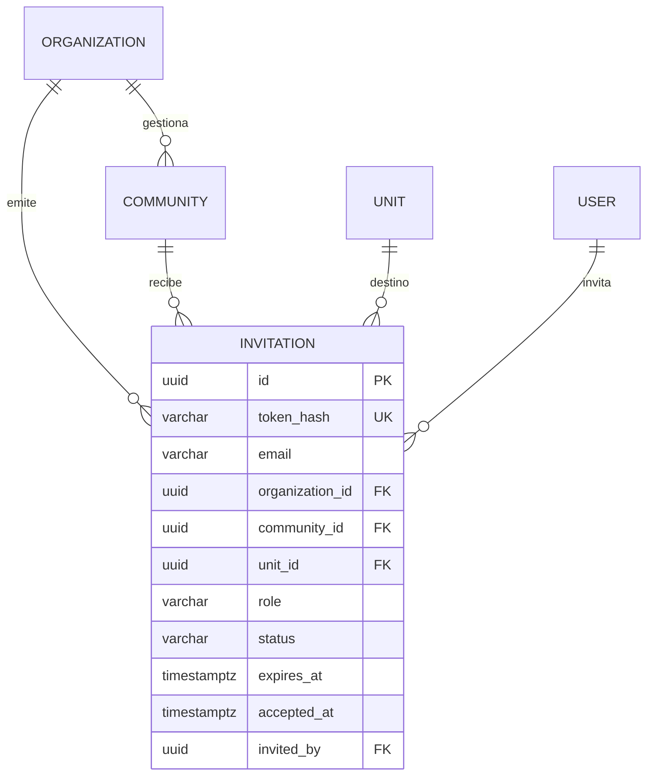

## Context

La fundación multi-tenant quedó archivada: existen organizaciones, comunidades,
torres, unidades y membresías con contexto activo en el JWT. Falta la capa de
**entrada**: cómo llega un usuario al portal de su comunidad, cómo se autentica, cómo
se incorporan los residentes y cómo el superadministrador crea la estructura.

Restricciones: multi-tenant por organización, email global único, dashboard React ya
existente, API Fastify, y Fase 1 sin proveedor de email ni subdominios.

## Goals / Non-Goals

**Goals:**

- Slugs únicos y estables para organizaciones y comunidades.
- Entrada por `/c/:slug` con branding público básico.
- Login acotado a la comunidad del slug.
- Invitaciones seguras y auditables para residentes y staff.
- Consola de plataforma para crear organizaciones, comunidades, torres y unidades.
- Mantener la identidad global y el cambio de contexto existente.

**Non-Goals:**

- No subdominios ni DNS/TLS wildcard.
- No branding avanzado (logo, colores, tema por comunidad).
- No SSO.
- No autoregistro con verificación.
- No envío real de emails en Fase 1 (se devuelve el link al administrador).
- No historial de slugs/aliases (se evalúa en Fase 2).

## Decisions

### 1. El slug de la comunidad es la llave de entrada

**Decisión:** `communities.slug` es único **globalmente** y es la llave de `/c/:slug`.
`organizations.slug` también es único y se usa para branding/enlaces futuros.

**Alternativas:** slug por organización (dos comunidades podrían repetir slug, pero el
path se vuelve más largo: `/o/:org/c/:slug`). Se descarta por simplicidad de enlaces.

**Consecuencia:** el slug es inmutable en la práctica; si se cambia, los enlaces viejos
dejan de funcionar. Se documenta y se evalúa una tabla de aliases en Fase 2.

### 2. Formato y palabras reservadas

**Decisión:** slug = minúsculas, dígitos y guiones; 3–60 caracteres; empieza y termina
con letra o dígito; sin guiones consecutivos. Palabras reservadas: `api`, `admin`,
`app`, `auth`, `c`, `login`, `platform`, `public`, `www`, `kiosk`, `resident`,
`static`, `health`.

**Alternativas:** permitir mayúsculas/underscores. Se descarta porque genera enlaces
ambiguos y problemas de SEO.

**Consecuencia:** la generación desde el nombre normaliza acentos y agrega sufijo
`-2`, `-3` ante colisiones.

### 3. Path en lugar de subdominio

**Decisión:** Fase 1 usa `/c/:slug`. Subdominio queda para cuando haya volumen y se
justifique el costo de DNS/TLS wildcard.

**Alternativas:** subdominio (`torre-norte.app.com`). Se descarta por operación y
porque el path da el 90% del beneficio con cero infraestructura extra.

### 4. El login sigue siendo global; el slug solo acota el contexto

**Decisión:** el login sigue siendo `POST /api/auth/login` con `{ email, password,
communitySlug? }`. Si viene `communitySlug`, el servidor resuelve la comunidad y
filtra las membresías del usuario a esa comunidad. El slug **no autentica**: la
autorización siempre sale de la membresía.

**Alternativas:** un endpoint de login por tenant (`/api/c/:slug/auth/login`). Se
descarta porque duplica la lógica y complica el refresh.

**Comportamiento:**
- Sin `communitySlug`: comportamiento actual (todas las membresías).
- Con `communitySlug` y una membresía en esa comunidad: tokens directos.
- Con `communitySlug` y varias membresías en esa comunidad: selección entre ellas.
- Con `communitySlug` y ninguna membresía: 403 sin revelar otras membresías.
- Platform admin: contexto de plataforma, independiente del slug.

### 5. Branding público mínimo

**Decisión:** `GET /api/public/communities/:slug` devuelve `{ id, name, slug, address,
timezone, organization: { id, name, slug } }`. Sin miembros, unidades ni datos
sensibles. Cacheable y con rate limit.

**Alternativas:** devolver más datos para la landing. Se descarta para no filtrar
información.

### 6. Invitaciones con token de un solo uso

**Decisión:** tabla `invitations` con `token_hash`, `email`, `organization_id`,
`community_id?`, `unit_id?`, `role`, `status`, `expires_at`, `accepted_at`,
`invited_by`. El token se genera con 32 bytes aleatorios, se guarda **solo el hash** y
se devuelve una única vez en el link. Expira en 7 días. Reenviar rota el token.

**Alternativas:** códigos cortos de 6 dígitos. Se descartan por fuerza bruta y porque
el link es más simple.

### 7. Aceptación segura

**Decisión:**
- Si el email **no existe**: `POST /api/public/invitations/:token/accept` con `{ name,
  password }` crea el usuario, la membresía, marca la invitación aceptada y devuelve
  tokens (auto-login).
- Si el email **ya existe**: la aceptación requiere `Authorization` de ese mismo
  usuario. Nunca se permite setear una contraseña nueva desde el token. Si no está
  autenticado, responde 409 “la cuenta existe, iniciá sesión”.
- El token es de un solo uso; aceptar dos veces devuelve 410.
- Rate limit por IP y por token.

**Alternativas:** permitir siempre setear contraseña. Se descarta: un link filtrado
permitiría tomar cuentas existentes.

### 8. Quién puede invitar

**Decisión:** según el alcance de la membresía:
- `org_admin`: cualquier rol dentro de su organización (incluido `community_admin`).
- `community_admin`: roles de su comunidad (`operator`, `guard`, `owner`, `tenant`,
  `resident`, `staff`).
- `platform_admin`: cualquier rol, incluido el primer `org_admin` de una organización.

La invitación se valida con las mismas reglas de alcance que `memberships`.

### 9. Consola de plataforma dentro del dashboard

**Decisión:** ruta `/platform` en el dashboard existente, protegida por
`isPlatformAdmin`. Endpoints `/api/platform/*` con guard de plataforma. En Fase 1 se
evita una app separada para no duplicar build/deploy.

**Alternativas:** app `apps/platform` separada. Se descarta por costo; se puede extraer
después sin cambiar la API.

**Consecuencia:** el guard de plataforma no usa membresía; el guard de tenant sigue
ignorando rutas `/api/platform/*`.

### 10. CRUD de estructura en plataforma

**Decisión:** el platform admin puede crear/editar organizaciones, comunidades, torres
y unidades. El `org_admin` no crea comunidades en Fase 1; sí puede gestionar usuarios e
invitaciones de su organización. Se evalúa delegar estructura al `org_admin` en Fase 2.

**Alternativas:** que el org_admin cree comunidades desde el inicio. Se posterga para
no ampliar el alcance.

### 11. Slug editable con advertencia

**Decisión:** el platform admin puede cambiar el slug, con confirmación explícita y
validación de unicidad. Los enlaces viejos dejan de funcionar; se documenta. Aliases
quedan para Fase 2.

**Alternativas:** slug inmutable. Se descarta porque un error de tipeo quedaría
permanente.

### 12. Seed y migración

**Decisión:** agregar slugs demo (`torre-norte`, `condominio-los-alamos`,
`administradora-demo`, `comunidad-independiente-demo`) y una invitación demo. La
migración agrega `slug` nullable, backfill desde el nombre, resuelve colisiones y luego
aplica `NOT NULL` + unique.

## Modelo de datos

## Migration Plan

1. Agregar `slug` nullable a `organizations` y `communities`.
2. Backfill con normalización de nombre; resolver colisiones con sufijo.
3. Aplicar `NOT NULL` y unique index.
4. Crear `invitations` con índices `(token_hash)`, `(email, status)`,
   `(community_id, status)`.
5. Actualizar seed con slugs e invitación demo.
6. Verificar `/c/torre-norte`, login acotado, aceptación nueva y existente.

**Rollback:** eliminar `invitations`, quitar unique e índices y columnas `slug`.

## Risks / Trade-offs

- **[Riesgo] Cambio de slug rompe enlaces** → Mitigación: confirmación explícita,
  validación y aliases en Fase 2.
- **[Riesgo] Enumeración de comunidades** → Mitigación: endpoint público solo devuelve
  branding, rate limit y cache.
- **[Riesgo] Token de invitación filtrado** → Mitigación: hash en DB, un solo uso,
  expiración, revocación y rate limit.
- **[Riesgo] Toma de cuenta existente** → Mitigación: email existente exige sesión y
  nunca permite cambiar contraseña desde el token.
- **[Trade-off] Sin email real en Fase 1** → El admin copia el link; se integra con
  `add-notification-service` después.
- **[Riesgo] Consola de plataforma en el mismo dashboard** → Mitigación: guard estricto
  `isPlatformAdmin` y rutas separadas; se puede extraer a app propia.

## Open Questions

- ¿La invitación de `org_admin` la emite el platform admin o se crea directo con
  contraseña temporal? Propuesta: invitación, para no manejar contraseñas temporales.
- ¿Expiración de 7 días o configurable por organización? Propuesta: 7 días global en
  Fase 1, configurable en Fase 2.
- ¿Se permite reenviar una invitación ya aceptada? Propuesta: no; se revoca y se crea
  una nueva.
- ¿Branding con logo? Propuesta: Fase 2; Fase 1 solo nombre, dirección y zona horaria.
