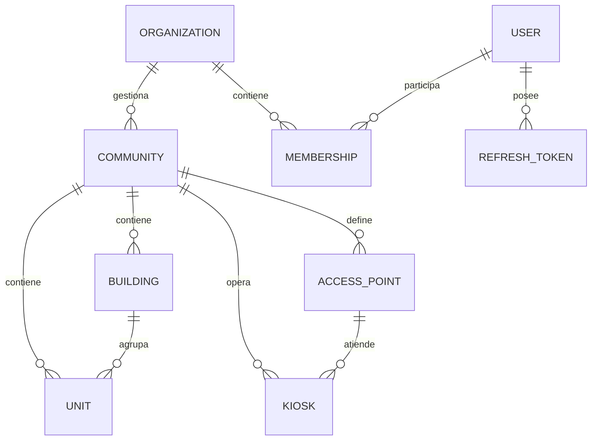

## Context

El sistema actual modela la operación de portería alrededor de `locations`, `kiosks`,
`access_points` y `users` con un rol único. No existe el concepto de unidad
(apartamento), ni de edificio/torre, ni de membresía multi-comunidad. El signaling usa
`buildingId` con el valor del `kioskId`, lo que confunde el dominio y bloquea el
enrutamiento por comunidad.

La plataforma objetivo es multi-tenant: varias organizaciones (administradoras,
empresas de seguridad o comunidades independientes) conviven en la misma instalación.
Este change establece la base de dominio sobre la que se construirán acceso, visitas,
citofonía, finanzas y analítica. No agrega funcionalidad de negocio nueva.

Restricciones: monorepo pnpm, Drizzle ORM con migraciones en
`packages/database/migrations`, Fastify, JWT + RBAC propio, despliegue único
(Docker Compose). No hay datos productivos que preservar; la migración es estructural
del esquema de desarrollo.

## Goals / Non-Goals

**Goals:**

- Jerarquía multi-tenant `organization → community → building → unit`.
- Membresías con rol por alcance que reemplazan el rol único de `users`.
- Contexto de membresía activo en el JWT y en el middleware RBAC.
- Kioscos vinculados a comunidad y punto de acceso (fin del alias `buildingId = kioskId`).
- Tipos compartidos y `Call` reconciliados con el schema.
- Migración Drizzle reproducible y seed multi-tenant.

**Non-Goals:**

- No se implementan credenciales de acceso, QR, biometría ni dispositivos.
- No se implementan visitas, paquetería, citofonía a residentes, pánico, reservas,
  tickets, comunicaciones ni finanzas.
- No se cambia el stack ni se introducen microservicios.
- No se implementa migración de históricos de producción.

## Decisions

### 1. Jerarquía de tenencia y renombre `locations` → `communities`

**Decisión:** `organization` es el tenant. Cada organización tiene muchas
`communities`. Cada comunidad puede tener `buildings` (torres) opcionales y `units`.
Se renombra la tabla `locations` a `communities` mediante migración con rename (no
drop/create), y los `access_points` pasan a referenciar `community_id`.

**Alternativas consideradas:**
- Mantener `locations` como "comunidad": menos churn, pero perpetúa la ambigüedad
  (`location` también se usa para dirección/geografía) y complica el lenguaje ubicuo.
- `community` como sinónimo de `organization`: no permite administrar varias
  comunidades por organización, que es un requisito del mercado (administradoras).

**Consecuencia:** `buildings` es opcional; una comunidad de una sola torre puede operar
sin filas en `buildings` (`units.building_id` nullable).

### 2. `memberships` como fuente única de autorización

**Decisión:** Se crea `memberships(id, user_id, organization_id, community_id?,
unit_id?, role, status, valid_from, valid_to)`. El rol vive en la membresía, no en el
usuario. Un usuario puede tener varias membresías (distintas orgs, comunidades o
unidades).

**Alternativas consideradas:**
- Rol único en `users` + tabla `user_units`: simple, pero no soporta staff que rota
  entre comunidades ni administradores de varias comunidades.
- Roles en `users` + `community_users`: cubre multi-comunidad pero no multi-org.

**Reglas:**
- `organization_id` siempre presente.
- `community_id` obligatorio para roles operativos (`community_admin`, `operator`,
  `guard`) y para residentes.
- `unit_id` obligatorio para `owner`, `tenant`, `resident` (ocupantes).
- Unicidad: `(user_id, organization_id, community_id, unit_id, role)` con `NULLS NOT
  DISTINCT` para evitar duplicados.

### 3. `super_admin` es de plataforma, no una membresía

**Decisión:** `users.is_platform_admin` (boolean) identifica al operador de la
plataforma. No se modela como membresía. Los roles de membresía son: `org_admin`,
`community_admin`, `operator`, `guard`, `owner`, `tenant`, `resident`, `staff`.

**Alternativas consideradas:**
- `membership` con `organization_id` nullable para super_admin: contamina todos los
  queries con `IS NULL` y rompe el aislamiento por tenant.

### 4. Contexto activo en el JWT

**Decisión:** El access token incluye `sub`, `orgId`, `membershipId`, `role` y,
cuando aplica, `communityId` y `unitId`. Si el usuario tiene varias membresías, el
login devuelve la lista y exige elegir una (o usa la única). Se agrega
`POST /api/auth/context` para cambiar de membresía y emitir un token nuevo.

**Alternativas consideradas:**
- Resolver el contexto por header `X-Community-Id` en cada request: más flexible, pero
  obliga a validar la membresía en cada endpoint y complica el RBAC.
- Tokens sin contexto y resolver en cada query: más consultas y riesgo de fuga entre
  tenants.

**Compatibilidad:** los refresh tokens existentes se revocan en la migración; el
frontend debe volver a loguearse.

### 5. Kioscos ligados a comunidad y punto de acceso

**Decisión:** `kiosks.community_id` (required) y `kiosks.access_point_id` (nullable).
El registro de signaling pasa a `kiosk:register { kioskId, communityId, name }`. El
servidor resuelve el kiosco por `kioskId` y persiste eventos usando
`community.organization_id`. Se elimina el uso de `buildingId` como id de kiosco.

**Alternativas consideradas:**
- Mantener `buildingId` como alias: evita tocar signaling, pero mantiene el bug y
  bloquea el enrutamiento multi-comunidad.

### 6. Unidades y ocupación vía membresías

**Decisión:** `units(id, community_id, building_id?, code, floor?, type, status)`.
La ocupación se expresa con membresías (`unit_id` + rol `owner|tenant|resident`). No se
crea una tabla `unit_occupancies` separada en esta fase; si en Fase 2 se necesita
histórico de ocupación, se agrega como extensión sin romper el modelo.

**Alternativas consideradas:**
- `unit_occupancies` dedicada: más explícita para histórico, pero duplica el concepto
  de membresía y complica el RBAC.

### 7. Estrategia de migración Drizzle

**Decisión:** generar el snapshot con `drizzle-kit generate` y luego ajustar a mano el
SQL de `0002_*.sql` para usar `ALTER TABLE ... RENAME TO` y backfill, en lugar de
drop/create. La migración se ejecuta en una transacción. El seed se reescribe para dos
organizaciones y varias comunidades/unidades.

**Alternativas consideradas:**
- Squash de migraciones: más limpio en dev, pero pierde trazabilidad y complica el
  rollback. Se descarta para mantener el historial.

### 8. Contrato de API

**Decisión:** los endpoints existentes se mantienen en su path, pero cambian los
payloads: `GET /api/users/me` devuelve membresías y contexto activo; los listados se
filtran por `orgId` y aceptan `communityId` opcional. Como es un cambio breaking, se
actualizan dashboard y signaling en el mismo change.

## Modelo de datos (fundación)

## Migration Plan

1. Crear rama y backup de la base de desarrollo (`pg_dump`).
2. Actualizar el schema Drizzle (`organizations`, `communities`, `buildings`,
   `units`, `memberships`, `users`, `kiosks`, `access_points`, `calls`, `events`).
3. Generar snapshot y escribir a mano `migrations/0002_establish_foundation.sql`:
   - `ALTER TABLE locations RENAME TO communities;`
   - crear `buildings`, `units`, `memberships`.
   - backfill: por cada `users` existente crear membresía con su rol/org/location;
     mapear `users.location_id` → `community_id`.
   - `ALTER TABLE kiosks ADD COLUMN community_id`; backfill desde
     `access_points.location_id`; luego `NOT NULL`.
   - mover `users.role/organization_id/location_id` a `memberships` y eliminar las
     columnas (o dejarlas nullable en una versión de transición; se eliminan en este
     change).
   - revocar `refresh_tokens` existentes.
4. `pnpm --filter @porteria/database db:migrate`.
5. Desplegar API y signaling juntos (dev: `pnpm dev:clean`).
6. Re-seed con `pnpm --filter @porteria/database db:seed`.
7. Verificar login, listado de kioscos, llamada kiosco↔operador y bitácora.

**Rollback:** restaurar el backup y volver al commit anterior. En dev, `db:drop` +
`db:migrate` es aceptable.

## Risks / Trade-offs

- **[Riesgo] Pérdida de datos en el rename/backfill** → Mitigación: transacción,
  backup previo y verificación de conteos antes/después.
- **[Riesgo] Tokens y sesiones viejas sin `orgId`** → Mitigación: revocar refresh
  tokens en la migración y forzar re-login.
- **[Riesgo] Romper dashboard/signaling por payloads nuevos** → Mitigación: actualizar
  frontend y signaling en el mismo change; prueba manual end-to-end del flujo de
  llamada.
- **[Trade-off] Membresías en lugar de `unit_occupancies`** → Menos tablas y RBAC
  unificado, a costa de no tener histórico de ocupación todavía.
- **[Trade-off] Contexto único por token** → Simple y seguro, pero requiere endpoint de
  cambio de contexto para usuarios con varias membresías.
- **[Riesgo] Scope creep hacia Fase 1/2** → Mitigación: los Non-Goals y el checklist de
  tasks excluyen explícitamente módulos nuevos.

## Open Questions

- ¿Un usuario puede ser `owner` y `tenant` de la misma unidad a la vez? Propuesta: no;
  la unicidad por `(user, community, unit, role)` lo permite pero la UI lo evita.
- ¿`buildings` se expone en la UI en Fase 1 o queda interno hasta la app residente?
  Propuesta: interno en Fase 1, visible en Fase 2.
- ¿Se agrega `communityId` como query param opcional en todos los listados desde ya?
  Propuesta: sí, para preparar el filtrado multi-comunidad.
