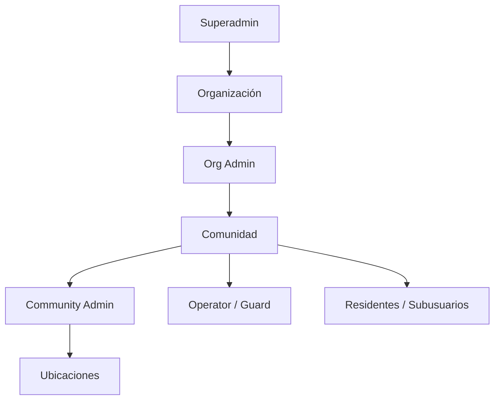

## Context

La fundación ya tiene organizaciones, comunidades, membresías y roles. La consola de
plataforma crea estructura e invitaciones, y el Admin panel crea usuarios. Faltan reglas
explícitas para que superadmin, org_admin y community_admin operen con alcances claros y
sin escaladas.

## Goals / Non-Goals

**Goals:**

- Una matriz de permisos única y testeable.
- Consolas claras por rol.
- Staff asociado a una o varias comunidades.
- Reportes globales/por organización/por comunidad.
- Aislamiento multi-tenant garantizado.

**Non-Goals:**

- No se define la jerarquía configurable de ubicaciones.
- No se separa persona/cuenta.
- No se implementan subusuarios.
- No se rediseña el QR.

## Decisions

### 1. Matriz de permisos declarativa

**Decisión:** una tabla de permisos por rol y alcance (`organization`, `community`,
`location`). El backend evalúa la membresía activa y el alcance; el frontend muestra solo
lo permitido.

**Alternativas:** chequeos ad-hoc por ruta. Se descarta.

### 2. Staff multi-comunidad

**Decisión:** una persona con rol operativo (operator/guard) puede tener varias
membresías, una por comunidad. La UI permite asignar una o varias comunidades al crear o
editar el staff.

**Alternativas:** una sola comunidad por staff. Se descarta por empresas de seguridad.

### 3. Superadmin administra staff y lee tenants

**Decisión:** el superadmin puede crear/editar operadores y guardias desde la consola de
plataforma, asignarles organización y comunidades, y consultar usuarios globales. Puede
leer organizaciones, comunidades, perfiles, secciones y unidades, pero no editarlos.

**Alternativas:** que solo el org_admin cree staff. Se descarta para onboarding inicial y
empresas de seguridad.

### 4. Org admin crea comunidades

**Decisión:** el org_admin puede crear/editar comunidades de su organización y administrar
todas ellas sin membership `community_admin`. No crea organizaciones ni staff de
plataforma. El superadmin no crea comunidades.

### 5. Community admin administra sus comunidades

**Decisión:** el community_admin gestiona estructura de ubicaciones, residentes y
usuarios de las comunidades asignadas; puede tener varias memberships
`community_admin`; no crea comunidades ni organizaciones.
### 6. Reportes por alcance

**Decisión:** superadmin ve reportes globales por organización/comunidad; org_admin por
organización; community_admin por comunidad. El filtro se aplica en el servidor.

### 7. Auditoría

**Decisión:** toda creación/cambio de estructura, staff, rol o permiso emite un evento
`admin.*` con actor y alcance.

## Modelo de permisos

## APIs

- `GET/POST/PATCH /api/platform/organizations`
- `GET /api/platform/communities` (read-only)
- `GET/POST/PATCH /api/organizations/:id/communities` (org_admin)
- `GET/POST/PATCH /api/platform/staff`
- `GET /api/platform/users`
- `GET /api/platform/reports/*`
- `GET/POST/PATCH /api/organizations/:id/communities` (org_admin)
- `GET/POST/PATCH /api/communities/:id/staff` (community_admin/org_admin)
- `GET /api/reports/*` con alcance por rol

## Risks / Trade-offs

- **[Riesgo] Matriz de permisos incompleta** → Mitigación: tests de matriz por rol.
- **[Riesgo] Staff con múltiples comunidades y contexto activo** → Mitigación: contexto
  explícito y selector.
- **[Riesgo] Duplicar roles existentes** → Mitigación: extender `membership-rbac`, no
  crear roles nuevos salvo necesidad.

## Open Questions

- ¿El superadmin puede crear staff sin organización? Propuesta: no; siempre asociado a
  una organización.
- ¿Un guardia puede estar en varias comunidades? Propuesta: sí, una membresía por
  comunidad.
