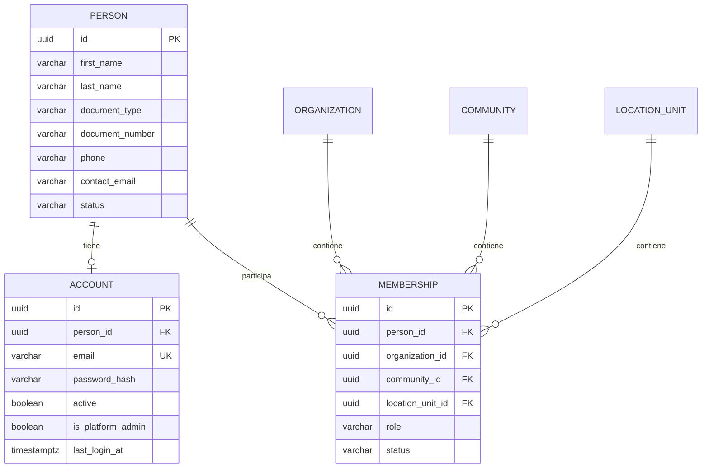

## Context

El modelo actual `users` contiene email, password, nombre, `is_platform_admin` y las
membresías apuntan a `user_id`. Esto mezcla identidad personal, credenciales y
autorización, y dificulta reutilizar una persona en varias comunidades o crear personas
sin cuenta.

## Goals / Non-Goals

**Goals:**

- Separar persona, cuenta, rol y asociación.
- Evitar personas duplicadas entre comunidades.
- Permitir personas sin cuenta (base para subusuarios).
- Migrar sin perder datos.
- Mantener login por email único.

**Non-Goals:**

- No se implementan subusuarios/permisos delegados.
- No se cambia la jerarquía de ubicaciones.
- No se implementa la consola administrativa nueva.

## Decisions

### 1. Persona global

**Decisión:** `people` es global (no por organización) con:
- `first_name`, `last_name`, `document_type`, `document_number`, `phone`,
  `contact_email`, `status`.

Identidad:
- `(document_type, document_number)` único cuando el documento está presente.
- `contact_email` no es identificador de login.

**Alternativas:** persona por organización. Se descarta: duplica personas.

### 2. Cuenta opcional

**Decisión:** `accounts` con `person_id`, `email` único, `password_hash`, `active`,
`is_platform_admin`, `last_login_at`. Una persona puede tener 0 o 1 cuenta. La cuenta es
la credencial de login; la persona es el sujeto.

**Alternativas:** una cuenta con múltiples personas. Se descarta: difícil de auditar.

### 3. Asociaciones contra la persona

**Decisión:** `memberships` pasa a `person_id` + organización/comunidad/ubicación + rol.
Una persona puede tener varias asociaciones y una sola cuenta. El staff y los residentes
se modelan con asociaciones.

**Alternativas:** asociaciones contra la cuenta. Se descarta: una persona sin cuenta no
podría tener asociaciones (subusuarios).

### 4. Login y claims

**Decisión:** login por `accounts.email`. El JWT lleva `sub = accountId`, `personId`,
`orgId`, `membershipId`, `role`, `communityId`, `unitId`, `isPlatformAdmin`. El frontend
sigue usando `user.id` como accountId y muestra `person` cuando necesita nombre/apellido.

**Alternativas:** `sub = personId`. Se descarta porque la credencial es la cuenta y puede
cambiar (email) sin cambiar la persona.

### 5. Migración de `users`

**Decisión:** por cada `users`:
1. crear `people` con nombre/apellido (si existe) y email de contacto;
2. crear `accounts` con email/password/is_platform_admin;
3. migrar memberships de `user_id` a `person_id`;
4. migrar `created_by`/`operator_id`/`actor_id` a `person_id` o `account_id` según
   corresponda;
5. conservar un mapa `userId → personId` para rollback.

**Alternativas:** mantener `users` y agregar tablas en paralelo. Se descarta para no
duplicar identidades.

### 6. Deduplicación

**Decisión:** al crear una persona:
- buscar por documento; si existe, reutilizar;
- si no hay documento, buscar por email de contacto + nombre;
- nunca crear dos personas para la misma identidad.

Al crear una cuenta:
- email único;
- si la persona ya tiene cuenta, rechazar o reenviar invitación.

### 7. Privacidad

**Decisión:** el documento y el teléfono son datos personales; se muestran según rol y se
enmascaran en listados. La cuenta nunca expone el hash.

## Modelo de datos

## Migration Plan

1. Crear `people` y `accounts`.
2. Backfill desde `users`.
3. Agregar `person_id` a memberships y backfill.
4. Migrar referencias (`created_by`, `operator_id`, `actor_id`) al sujeto correcto.
5. Ajustar auth y DTOs.
6. Dejar `users` como vista/compatibilidad temporal y luego eliminarla.
7. Verificar login, membresías y reportes.

## Risks / Trade-offs

- **[Riesgo] Pérdida de vínculos** → Mitigación: mapa `userId → personId` y backup.
- **[Riesgo] Tokens existentes** → Mitigación: revocar refresh tokens en la migración.
- **[Riesgo] Duplicados por email/documento** → Mitigación: constraints y merge manual.
- **[Trade-off] `sub = accountId`** → Cambia el contrato del token; se versiona y se
  actualiza el frontend/app.

### 8. Organization legal representative

**Decisión:** `organizations.legal_representative_person_id` references `people`. The
representative may have no account. The organization administrator is resolved from the
active `org_admin` membership, not from a duplicate name/email column.

## Open Questions

- ¿Una persona puede tener más de una cuenta? Propuesta: no.
- ¿El documento es obligatorio? Propuesta: obligatorio para residentes/staff; opcional
  para casos legacy.
- ¿El email de contacto puede ser nulo? Propuesta: sí para subusuarios sin cuenta.
